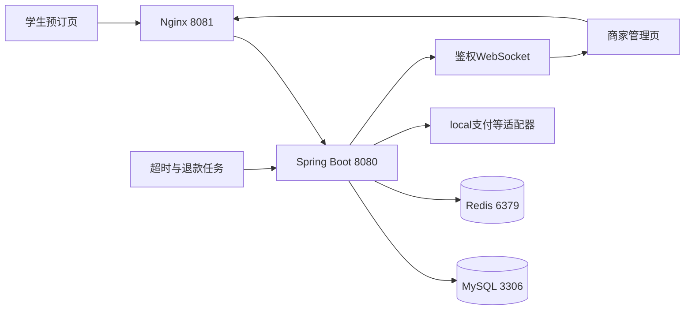

# 校园午餐预订与自提系统

**campus-meal-reservation：基于苍穹外卖的个人改造，重点是下单正确性、限额预约、自提核销与退款恢复。**

学生按餐次提前预订，商家按已支付订单的份数集中备餐，取餐时凭码核销。项目保留原外卖配送流程，新增校园自提规则，并修复原代码中的计价、事务、购物车数量、状态迁移和用户权限问题。

本 README 集中提供项目介绍、贡献边界、业务规则、技术方案、失败处理、验证证据及面试问答依据。没有阅读过聊天记录的读者，可以从这里理解项目；需要核对实现时，继续打开各节的源码链接。网页工具可能截断长页面，完整内容可通过仓库的 **Raw README** 获取。

## 1 项目事实速览

| 维度 | 已实现或已验证的事实 |
| --- | --- |
| 来源与性质 | 基于 [shuhongfan/sky-take-out](https://github.com/shuhongfan/sky-take-out) 的个人学习改造；上游基准提交 [267313f](https://github.com/shuhongfan/sky-take-out/commit/267313f948bba2001fbc497995a39ef61f2c621f)，不是从零独立开发全部模块 |
| 原有基础 | 员工、分类、菜品、套餐、地址、购物车、外卖订单、工作台、统计报表、Redis菜单缓存、JWT登录、WebSocket通知等 |
| 新增场景 | 餐次发布与开关、容量和截单、预占及释放份数、备餐汇总、自提时段、随机取餐码、一次核销、学生页与商家管理页 |
| 核心改造 | 服务端计价和价格快照、持久化请求幂等、购物车与结算协调、条件状态更新、迟到支付处理、持久化退款任务、归属校验与身份清理 |
| 技术架构 | 单体 Spring Boot 2.7.3 + Java 8 + MyBatis + MySQL 8；Redis用于菜单缓存及营业状态；Vue 2 + TypeScript；Nginx反向代理；Flyway迁移 |
| 一致性方案 | 同库业务使用本地事务、行锁、唯一约束和条件SQL；退款使用持久化意图、稳定退款号、租约及重试，不是跨支付平台的原子事务 |
| 验证记录 | 2026-10-11：43项单测及基础检查；2026-10-14：55项单测及可靠性迭代；2026-10-15：58项单测、自动恢复、大表及多轮负载；2026-10-19：59项单测、24组同单历史/126次操作及18组调度对照；2026-10-19至20：63项单测、14项退款核查及既有链路回归；均保留分轮记录 |
| 并发正确性结果 | 50个同键请求只创建1单；20用户争抢5份只成功5单；20次并发接单与20次并发核销分别只有1次状态迁移成功 |
| 真实运行范围 | 本地Java、MySQL、Redis、Nginx、HTTP接口和Vue构建；微信授权、支付、退款、OSS、地图由local适配器模拟 |
| 尚未完成 | 真实商户联调、支付对账、证书轮换、跨机器部署与数据库切换、数小时稳定性及生产容量认证、可靠通知outbox、浏览器自动点击与微信开发者工具验收 |

**学习和面试时的三个核心主题：下单幂等与事务、容量及状态竞争、退款的故障恢复。** 本项目没有实现Redis分布式锁扣库存、Kafka/RabbitMQ、微服务拆分或完整支付对账，不应把这些写成个人贡献。小批并发正确性检查不代表生产吞吐能力。

2026-10-14新增[订单可靠性迭代](docs/RELIABILITY_ITERATION.md)：区分提交前写入与提交后的响应丢失，用独立SQLite模拟端验证退款恢复，增加整事务重试与双实例负载实验，并定位、修复取消过程中的外键共享锁升级死锁。历史验证没有被这些新结果覆盖；源码、复现脚本与脱敏证据一并保留。

2026-10-15新增[后台自动恢复与大表验证](docs/BACKGROUND_RECOVERY.md)：修复慢退款阻塞调度，使用有界工作池、执行时领取及单项异常隔离；58项单测、11项自动后台检查、31项既有可靠性回归通过。十万退款任务验证了V5索引；三轮共六组120秒负载及144笔随机竞争完成。首次负载曾出现建连超时，后续未复现但根因未确认，失败轮也保留在[该轮脱敏证据](docs/evidence/background-2026-10-15.json)。

2026-10-19增加[同单状态历史与调度对照](docs/STATE_HISTORY_AND_SCHEDULING.md)：独立业务模型检查并发响应与实时先后关系，隔离库的事务内记录检查已提交状态链；把后台自动退款与显式支付回调重投分开验证。使用同一构建包做同步/异步执行与1/2调度线程的对照，再检查退款工作线程占满的边界。测试记录不是生产审计功能，同步对照仅local显式开启，默认关闭。

该轮24组历史共126次操作、27项过程与恢复检查、18组调度对照均通过；59项Java单测及31项旧故障回归通过，模型检查器另有5项检查。原始时间、逐次操作及限制见[该轮脱敏证据](docs/evidence/state-history-2026-10-19.json)。仅增加调度线程能隔离超时扫描，不能让同步退款逐笔循环并行；异步退款工作线程全占满时，普通退款仍等待。支付回调丢失仍需要重投，尚无主动支付对账。

2026-10-19至20完成[退款核查与人工恢复](docs/REFUND_REVIEW.md)：后续尝试先查原退款号，区分本地任务失败和平台最后结果，人工重置与操作记录同事务；候选扫描跳过被锁行，修复前20条受阻导致第21条不能推进的问题。63项单测、14项退款核查、31项故障回归、11项后台检查、27项状态历史检查和8项大表检查通过，Vue构建成功。十万任务上核实锁定SQL的计划与实际返回；没有复跑持续负载或真实资金验收。原版JAR对照、失败夹具及本轮结果见[脱敏证据](docs/evidence/refund-review-2026-10-19.json)。

## 2 业务流程与规则

1. 商家发布未来7天内的餐次，设置标题、日期、可售份数、截单时间和自提开始/结束时间；商家可以停止接收新的预订。
2. 学生登录，选择餐次与菜品，填写取餐人及手机号。提交时服务端重新计价，原子预占餐次份数，写入订单与明细，清理购物车。
3. 支付成功后进入待接单；商家接单、按菜品汇总已支付且未完成订单的份数，并在备餐完成后标记待自提。
4. 工作人员在指定取餐时段输入学生的取餐码，订单从待自提变为已核销；重复核销被拒绝。
5. 学生在截单前且订单未接单时可取消；已支付取消进入退款处理。接单后、截单后等异常情况由商家处理。

| 规则 | 当前实现 |
| --- | --- |
| 容量定义 | 餐次总份数，按购物车数量求和；一个菜品或套餐计一份，不是每个菜品的原料库存 |
| 餐次限制 | 容量1至5000；截单必须早于自提开始，自提结束晚于开始；自提在同一个餐次日期内 |
| 预占时机 | 下单即预占；支付后继续占用；取消/超时释放；核销后保留为该餐次已售份数 |
| 数量限制 | 每行1至99份，单笔最多200份；当前学生页面主要展示菜品，后端计价同时支持套餐 |
| 费用 | 菜品/套餐总价 + 每份1元餐盒费；自提配送费0元，原配送流程配送费6元；费用从服务器配置读取 |
| 超时 | 待支付订单下单15分钟后，或者餐次截单后，可被每30秒扫描的任务取消；扫描后逐单重新检查 |
| 学生取消 | 订单状态1或2，且自提餐次尚未截单；重复取消返回成功但不重复释放份数 |
| 商家取消 | 已完成订单不能直接取消；其他有效状态可由商家处理，已支付的同时创建退款意图 |
| 自提完成 | 必须已支付、待自提、取餐码有效且处于取餐时段；普通配送完成入口不接受自提订单 |
| 未按时取餐 | 当前保持原订单状态，由商家处理；没有自动认定取餐、夜间自动完成或自动退款规则 |
| 时间 | 业务Clock使用Asia/Shanghai；HTTP时间输入兼容分钟及秒，现有响应时间展示精确到分钟 |

“备餐汇总”包含已支付且状态2、3、4的订单数量，即未完成履约的需求总量；不是只统计尚未制作的订单，也不是自动生成采购单。

## 3 原代码问题与实际贡献

下表基于上述上游提交的代码核对，区分缺陷修复和新增设计。继承模块的存在不等于这些模块全部由本项目作者开发。

| 原代码或原方案 | 当前改造 | 可观察结果 |
| --- | --- | --- |
| 下单直接把客户端DTO中的amount复制到订单 | 从数据库读取当前菜单价格与销售状态，使用BigDecimal，保存价格与数量快照 | 篡改请求总价、餐盒费、购物车单价仍按菜单结算；历史订单不随菜单改价 |
| 订单主表、明细、清购物车没有统一事务保护 | 将这些操作和新增容量预占纳入同一事务 | 明细写入失败，订单不残留、购物车保留、名额回滚 |
| 更新购物车数量的SQL只更新amount，插入也未显式保存number | 修正数量SQL并重构购物车加减/再购 | 多次添加正确增加份数，结算与并发加购协调 |
| 完成订单使用新对象的空ID，且状态设为CONFIRMED | 使用正确ID，条件更新4到5并记录完成时间 | 正常完成生效，重复/乱序操作被拒绝 |
| 用户取消退款从新对象读取空amount；同步外部调用缺少持久化恢复 | 使用数据库订单金额，取消与退款意图同事务，外部调用在事务外重试 | 失败后有可恢复、可查询、可人工重试的任务 |
| 部分订单/地址按ID操作未充分校验归属 | 根据当前登录用户校验归属，不接受客户端注入userId | 第二个用户无法操作第一个用户的对象 |
| 支付成功处理依赖当前登录用户ThreadLocal | 按订单号定位，验证通知和金额；回调与登录上下文分离 | 外部回调无需用户登录线程；重复/迟到回调按订单状态处理 |
| 接单、支付、超时取消存在先读后写竞争 | 订单行锁与带原状态条件的更新 | 同一状态只成功迁移一次，取消不会被迟到支付恢复 |
| 订单分页逐单查询明细 | 一次查询该页订单的明细，再分组组装 | 消除该路径逐单查明细的N+1结构；没有宣称实测性能提升百分比 |
| 缺少持久化请求级幂等与购物车并发约束 | 用户行锁、请求指纹、唯一约束和历史结果复用 | 同键并发、不同键竞争、购物车变更和重启重试有明确行为 |
| 教学周期WebSocket广播不是业务JSON事件 | 默认关闭教学广播，增加管理JWT握手和注册确认消息 | 客户端可区分HTTP升级与业务会话就绪；仅提交后通知业务事件 |

运行基线还修复了管理员初始密码与MD5校验不一致、Redis营业状态缺省处理、注册审计字段不适用、报表模板缺失及导出响应、部分路径变量绑定和地图响应解析问题。地图修复保留代码，真实地图联调尚未验收。

2026-10-14公开整理时额外移除了上游硬编码外部凭证，改为环境变量、默认local profile，补充可独立克隆的初始SQL与发布说明。新Git历史从清理后的快照开始，上游来源仍明确标注。

## 4 架构与代码地图



后端是同一Spring Boot应用中的多个业务模块。MySQL存储订单、明细、购物车、餐次与退款任务；Redis主要承载继承的菜单缓存及营业状态。结算直接读取数据库，不用Redis缓存价格作为支付依据。

| 模块 | 入口 |
| --- | --- |
| 下单、支付、取消、幂等与状态 | [OrderServiceImpl](sky-take-out/sky-server/src/main/java/com/sky/service/impl/OrderServiceImpl.java) |
| 计价与快照 | [OrderPricingService](sky-take-out/sky-server/src/main/java/com/sky/service/OrderPricingService.java) |
| 用户串行协调、购物车 | [UserLockService](sky-take-out/sky-server/src/main/java/com/sky/service/UserLockService.java)、[ShoppingCartServiceImpl](sky-take-out/sky-server/src/main/java/com/sky/service/impl/ShoppingCartServiceImpl.java) |
| 餐次、备餐、自提核销 | [MealSessionService](sky-take-out/sky-server/src/main/java/com/sky/service/MealSessionService.java)、[MealSessionMapper](sky-take-out/sky-server/src/main/java/com/sky/mapper/MealSessionMapper.java) |
| 退款任务 | [RefundService](sky-take-out/sky-server/src/main/java/com/sky/service/RefundService.java)、[RefundTaskMapper](sky-take-out/sky-server/src/main/java/com/sky/mapper/RefundTaskMapper.java) |
| 订单条件SQL | [OrderMapper](sky-take-out/sky-server/src/main/java/com/sky/mapper/OrderMapper.java)、[OrderMapper.xml](sky-take-out/sky-server/src/main/resources/mapper/OrderMapper.xml) |
| 超时与业务时间 | [OrderTask](sky-take-out/sky-server/src/main/java/com/sky/task/OrderTask.java)、[BusinessTimeConfiguration](sky-take-out/sky-server/src/main/java/com/sky/config/BusinessTimeConfiguration.java) |
| 身份与通知鉴权 | [IdentityContextFilter](sky-take-out/sky-server/src/main/java/com/sky/filter/IdentityContextFilter.java)、[AdminWebSocketFilter](sky-take-out/sky-server/src/main/java/com/sky/filter/AdminWebSocketFilter.java) |
| 非local支付通知 | [PayNotifyController](sky-take-out/sky-server/src/main/java/com/sky/controller/notify/PayNotifyController.java)、[WeChatNotificationVerifier](sky-take-out/sky-server/src/main/java/com/sky/service/WeChatNotificationVerifier.java) |
| 学生与商家页面 | [Customer.vue](project-rjwm-admin-vue-ts/src/views/meal/Customer.vue)、[Management.vue](project-rjwm-admin-vue-ts/src/views/meal/Management.vue) |
| 数据库迁移 | [V2](sky-take-out/sky-server/src/main/resources/db/migration/V2__reservation_and_order_integrity.sql)、[V3](sky-take-out/sky-server/src/main/resources/db/migration/V3__pickup_without_delivery_address.sql)、[V4](sky-take-out/sky-server/src/main/resources/db/migration/V4__user_scoped_cart_indexes.sql) |
| 验证脚本 | [smoke.py](scripts/smoke.py)、[feature_checks.py](scripts/feature_checks.py)、[check-wechat-request.cjs](scripts/check-wechat-request.cjs) |

目录保留上游的`sky-take-out/`和`project-rjwm-admin-vue-ts/`命名，业务改造不是通过目录改名完成的。`sky-common`包含工具与公共结果，`sky-pojo`包含实体/DTO/VO，`sky-server`包含控制器、服务和持久化。

## 5 下单事务与持久化幂等

一笔新结算的顺序是：**校验请求 → 锁当前用户行 → 查询已有请求结果 → 校验营业/地址 → 锁定购物车和当前菜单 → 预占餐次份数 → 写订单与快照 → 清购物车 → 提交。**

### 请求协议

- requestKey由客户端生成，格式为8至64位字母、数字、下划线或连字符，以用户为作用域；开始另一笔结算必须使用新键。
- 数据库唯一约束是`(user_id, request_key)`。SHA-256指纹记录餐次、联系信息、备注、餐具和配送等参数，忽略客户端计价字段。
- 已有同键且指纹相同，返回同一订单；指纹不同，拒绝把同一个键用于另一组参数。
- 查询已有订单先于购物车、营业和容量判断，所以第一次成功后购物车已清空、餐次已关闭、服务已重启，重试仍返回原结果。
- 请求键代表一次购物车结算，**指纹不包含重试时的当前购物车**。原结果不会因为后来加购而改变；若要多设备严格草稿版本语义，需另加购物车版本或持久化结算草稿。
- Vue把原请求保存在按用户区分的localStorage草稿中，结果不确定时阻止换新键；明确业务拒绝才清理草稿。微信客户端按登录响应的用户ID区分草稿，JWT续签、401、503和网络失败保留原载荷，切回原用户可恢复。

### 用户行锁和唯一约束各自解决的问题

唯一约束防止同键写两条订单；用户行锁还协调同一用户用两个不同键同时结算，以及加减购物车与结算之间的竞争。所有这些写入口先锁同一个用户行，因此不同请求键也不能同时消费同一份购物车。

不同用户不共用用户锁；抢同一餐次时竞争该餐次行。这是数据库行锁，不是单个JVM中的synchronized锁，也没有实现Redis分布式锁。2026-10-14已用两个本机Java实例共享测试库验证同键下单、不同键与购物车竞争、20用户抢5份、退款领取及迟到结果隔离；跨机器、网络分区与数据库主从切换未验证。

### 容量SQL和回滚

```sql
UPDATE meal_session
SET reserved_count = reserved_count + :quantity
WHERE id = :sessionId
  AND status = 1
  AND cutoff_time > :now
  AND reserved_count + :quantity <= capacity;
```

影响1行才继续创建订单；否则拒绝预订。容量、订单主表、明细和清理购物车属于同一事务，使用`rollbackFor=Exception.class`。数据库CHECK另外限制`0 <= reserved_count <= capacity`。预占成功后明细插入失败，也会撤销预占。

### 隔离级别与一次实际排障

下单和报价事务使用READ COMMITTED；菜单按稳定类型/ID顺序进行FOR SHARE读取，当前价格与销售状态在提交前受锁保护。幂等结果和购物车使用锁定读，修改名额使用条件更新。

实际20用户竞争测试曾在购物车FOR UPDATE查询发生死锁。原购物车表缺少合适的用户范围索引，锁定查询会扫描过多记录；不存在的幂等键在默认隔离级别下也可能保留不必要的间隙锁。补充`shopping_cart(user_id,id)`等索引，并局部使用READ COMMITTED后，该检查通过。

该隔离级别仍可能出现其他死锁，外键/重复键检查也有自己的锁行为；没有宣称全系统永不死锁。当前服务端对明确的MySQL 1213死锁和1205锁超时最多尝试3次，每次先回滚并开启新事务，保留原键；事务外调用支付/退款的方法不整体重试，断连等结果不明的错误也不自动重试。完整失败语义见[本轮设计](docs/RELIABILITY_ITERATION.md)。MySQL规则参考[隔离级别](https://dev.mysql.com/doc/refman/8.0/en/innodb-transaction-isolation-levels.html)和[锁定范围](https://dev.mysql.com/doc/refman/8.0/en/innodb-locks-set.html)。

持续负载还发现：取消先改订单状态，经外键检查持有餐次S锁，再减名额需要升级X锁，并发取消因此死锁。修复为锁订单后先释放容量取得餐次X锁，再改变订单状态；迟到支付同样处理，后续SQL失败时容量释放仍随事务回滚。这是实际锁日志发现的问题，详见[死锁证据](docs/evidence/cancellation-fk-deadlock.txt)。

## 6 计价与数据模型

商品必须是一个菜品或一个套餐，价格为正且当前启售，数量和口味说明满足限制。`OrderPricingService`重新读取菜单，忽略购物车中的价格/名称和客户端amount、packAmount。金额使用BigDecimal，数据库使用DECIMAL；前端数值仅用于展示。报价是当前估算，最终订单以提交时重新确认的价格为准，支付使用已保存订单金额。

示例：3份单价10.10元的菜品，餐盒费3元；自提订单33.30元，配送订单39.30元。明细保存每份10.10元及数量3，不能把单价和行小计混用。菜单之后改价不影响已生成订单。

原11张业务表保留：employee、category、dish、dish_flavor、setmeal、setmeal_dish、user、address_book、shopping_cart、orders、order_detail。新增meal_session、refund_task与refund_review，加Flyway历史表共15张。

| 关键表 | 新增或重要字段与约束 |
| --- | --- |
| meal_session | 日期、cutoff_time、pickup_start/end、capacity、reserved_count、status；容量CHECK；日期与营业查询索引 |
| orders | request_key/hash、fulfillment_type、meal_session_id、reserved_quantity、pickup_code、delivery_fee、refund_status；请求键/订单号/核销码唯一；超时与餐次索引 |
| order_detail | 商品名称、单价、数量等订单快照；分页时按一组order_id批量查明细 |
| refund_task | order_id、refund_number、status、attempts/failures、provider_submitted、provider_state/checked_time、next_retry_time、lease_until/token、诊断与时间；订单和退款号各自唯一 |
| refund_review | task_id、operator_id、reason、previous_provider_state/failures及create_time；任务重置与人工恢复记录同事务 |
| shopping_cart | user_id与id索引，显式维护number；与用户行锁配合协调修改和结算 |

orders主键仍为数据库自增ID；对外订单号使用32位去连字符UUID并有唯一约束。UUID随机订单号不是聚簇主键，也不是雪花ID服务。fulfillmentType为1配送、2自提；配送需要地址，自提地址ID为空，使用联系信息与餐次。V3的CHECK限制履约字段组合。

初始SQL见[scripts/sql/000-initial-schema.sql](scripts/sql/000-initial-schema.sql)。bootstrap仅在业务表为空时导入，Flyway为已有原表建立V1基线：V2增加餐次、订单字段、退款表；V3允许自提无配送地址并加履约约束；V4补用户范围索引；V5补退款租约索引；V6增加平台最后结果和人工恢复记录。已经执行的迁移不能直接改内容，应添加新版本。

## 7 状态迁移与迟到支付

| 状态值 | 配送 | 自提 | 正常进入条件 |
| --- | --- | --- | --- |
| 1 | 待支付 | 待支付 | 下单成功 |
| 2 | 待接单 | 待接单 | 金额匹配、有效期内的支付成功 |
| 3 | 已接单 | 备餐中 | 已支付，原状态2 |
| 4 | 派送中 | 待自提 | 已支付，原状态3，履约入口匹配 |
| 5 | 已完成 | 已核销 | 已支付，原状态4；自提还需核销码和时段 |
| 6 | 已取消 | 已取消 | 满足用户、商家或超时取消规则 |

payStatus：0未支付、1已支付、2已退款。refundStatus：NONE、PENDING、FAILED、SUCCEEDED。取消订单和退款完成是两个不同事实；已取消且已支付可能正在等待退款。

状态迁移采用类似下面的SQL，并检查影响行数：

```sql
UPDATE orders SET status = :next
WHERE id = :id AND status = :expected AND pay_status = 1;
```

支付、取消、超时和核销读取订单行锁，再依据当前状态决定操作。重复取消不再次释放份数；重复支付回调不再次推进状态，也不重复创建退款意图。普通接单等单条状态迁移通过条件更新防止先查后改之间的竞争。

**支付与取消竞争的两条路径：**有效支付先完成，则订单已支付，取消时创建退款意图；超时/取消先完成，则迟到支付保持订单取消并创建退款意图。回调本身也重新检查15分钟期限和餐次截单时间，不依赖定时任务恰好先执行。已经释放的名额不能再释放一次。

核销码来自16字节SecureRandom，使用URL安全Base64编码为22位字符串并有唯一约束。用户只能查询自己订单的码，管理员负责核销；随机码降低猜测可能性，不能替代权限、时段和状态校验。当前为输入码核销，没有实现扫码设备集成。

## 8 持久化退款与失败恢复

1. **保存意图：**取消已支付订单时，订单变更与refund_task入库在同一事务；退款号固定为`R`加订单号，订单ID和退款号都有唯一约束。
2. **领取任务：**默认每3秒用READ COMMITTED短事务和SKIP LOCKED取候选，跳过其他事务锁住的任务；两分支各最多20条，合并最多20条。扫描提交后交给每实例2个工作线程、16个排队位置的有界执行池；真正执行才领取、分配2分钟租约与令牌。队列满不领取，后续扫描可恢复。
3. **外部调用：**放在数据库事务外，避免网络等待长期占有订单锁；后续尝试先查询原退款号，只有明确NOT_FOUND才同号同金额重提。查询错误不能当作“平台未处理”。
4. **确认结果：**平台明确成功后，短事务按订单→退款任务的顺序锁定/更新，并按当前任务令牌完成任务和订单退款状态。
5. **继续处理：**PROCESSING默认60秒后查询，持续处理时逐步降低查询频率；六次累计本地失败、超24小时仍PROCESSING、平台明确CLOSED/ABNORMAL时转FAILED待人工处理。人工重试必须填写原因，任务重置、订单状态与操作记录同事务；仍先查原号。
6. **恢复崩溃：**PROCESSING租约过期后可重新领取；旧执行者的令牌不能覆盖新领取者的数据库结果。

任务状态：`PENDING → PROCESSING → SUCCEEDED`；可重试失败回到PENDING，达到阈值进入FAILED，人工重试再回到PENDING。V6的provider_state另行保存平台最后结果，FAILED不等于平台未退款。退款成功确认之前订单不能显示已退款。

若平台已处理但本地没拿到响应，稳定退款号和后续重试/查询用于恢复确认，不能换新退款号盲目重发。这是可恢复的最终一致性方案：**不保证外部接口仅调用一次，不是两阶段提交，也没有完整的支付账单对账。** 租约令牌约束本地写回，无法单独约束支付平台。

当前保存有界诊断和人工恢复记录，平台长期处理中会停止自动轮询并进入待人工处理；尚无生产告警和完整资金审计。真实资金一致性仍需要商户联调、通知和主动对账共同验证。[微信退款查询接口](https://pay.wechatpay.cn/doc/v3/merchant/4012791884)

2026-10-19补充[退款核查与人工恢复](docs/REFUND_REVIEW.md)：默认后续尝试先查询原号，区分任务失败与平台最后结果，人工恢复留存原因及操作人；候选短事务跳过已被锁住的行，解决整批受阻时后续任务不能推进的问题。原锁定夹具曾因全索引扫描误锁正常行，修正为主键等值锁并独立验证后重新对照，失败记录保留。

2026-10-15的[后台恢复迭代](docs/BACKGROUND_RECOVERY.md)修复了慢退款对调度线程的阻塞：扫描不等待外部接口，调度池显式设为2个线程；单项失败不终止超时批次或其他退款工作。进程内集合只防重复排队，任务的持久化与跨实例领取仍由MySQL负责。

## 9 权限与通知边界

- **对象归属：**订单详情、取消、再购、催单、预支付等按当前用户校验；地址读写与默认设置同样限制归属，忽略客户端userId注入。
- **身份清理：**过滤器进入请求前清理ThreadLocal，在finally再次清理，防止线程池复用和异常路径遗留身份。异步退款与外部通知不依赖用户线程身份。
- **WebSocket：**握手验证管理JWT，令牌放在子协议头`sky-admin, auth.<JWT>`，不放URL查询串；注册后发送type=0确认，提交后发送来单/催单事件。
- **通知可靠性：**会话并发访问受保护，旧会话关闭不会误删同sid的新会话；消息没有持久化、消费确认或断线补偿，订单列表仍是业务事实来源。
- **非local支付通知：**先验证配置的平台证书、序列号、原始正文RSA签名和300秒时间窗口，再AES-GCM解密并校验appid、商户、交易状态、币种和金额；有效处理返回204。
- **协议验收范围：**RSA与AES-GCM协议样本有单测，真实平台证书轮换、公钥模式、商户回调部署、退款通知和支付对账尚未完成。[微信支付通知文档](https://pay.wechatpay.cn/doc/v3/merchant/4012791902)
- **配置：**外部凭证与JWT密钥使用环境变量，本地由脚本随机生成。管理员密码仍沿用教学项目MD5校验，管理权限仍是原管理JWT体系，尚未扩展完整RBAC。

## 10 验证结果和解释范围

业务正确性验证记录于**2026-10-11**。后端为单个Spring Boot实例，MySQL与Redis真实运行，local连接池最多10个连接，HTTP经Nginx；并发检查用Python线程屏障释放一批请求，支付/退款为模拟接口。

| 检查 | 结果 | 脚本或证据 |
| --- | --- | --- |
| Java单元测试 | 43项，0失败、0错误 | [src/test](sky-take-out/sky-server/src/test/java/com/sky)、Maven构建 |
| 原业务流程 | 67项通过 | [smoke.py](scripts/smoke.py) |
| 校园流程与故障注入 | 39项通过 | [feature_checks.py](scripts/feature_checks.py) |
| 完整停止/启动及幂等重放 | 3项通过，和上述合计42项 | `feature_checks.py --replay-only` |
| 编译后微信请求兼容 | 5项通过 | [check-wechat-request.cjs](scripts/check-wechat-request.cjs) |
| Vue源码构建 | 成功，含campus和meal资源，有资源体积告警 | [build-front.ps1](scripts/build-front.ps1) |

| 并发场景 | 请求数 | 预期结果与实际断言 |
| --- | --- | --- |
| 同用户同键提交 | 50 | 50个响应返回同一订单；仅1条订单，3份只预占一次 |
| 重复支付通知 | 20 | 20个回调接受，只推进一次；已注册连接收到1条来单事件 |
| 同一订单接单 | 20 | 1次成功、19次状态拒绝 |
| 不同用户竞争5份 | 20 | 5单成功、15单容量拒绝；失败用户购物车保留 |
| 同一订单取消 | 10 | 都可重试，但只释放1份 |
| 加购与结算竞争 | 2 | 已下单数量+剩余购物车数量=2，商品数量守恒 |
| 过期退款租约领取 | 10 | 领取次数只增加1，旧令牌失效，任务完成 |
| 同一取餐码核销 | 20 | 1次成功、19次拒绝 |

故障检查包括金额和购物车价格篡改、停售、双用户越权、提前核销、截单后预订/取消、未支付超时、迟到支付、临时触发器强制明细失败、退款1次失败与6次失败、人工重试、崩溃租约恢复及全服务重启。触发器结束后删除，菜单临时变更在finally恢复；时间和崩溃状态仅对本次本地夹具设置。

实际一次P95：同键提交222.65ms、20用户竞争5份132.64ms、并发核销77.47ms；详细数值见[验证记录](docs/VALIDATION.md)。这些是小批本地功能检查的请求耗时，包含线程调度和网络开销，**没有持续压测、优化前后对照或生产用户规模**。规则拒绝是预期业务结果，不是隐藏失败。

公开仓库提供[脱敏验证摘要](docs/evidence/validation-summary.json)。原日志、JWT、随机本地密钥、数据库目录和运行报告中的执行夹具不上传；克隆后可用脚本重新生成`.local`中的报告。摘要记录历史结果，不表示GitHub CI已执行。

2026-10-14从独立发布目录重新构建后端，43项Java单测与5项微信请求兼容检查再次通过；该次发布整理不改变上述业务并发实验的日期和解释范围。

随后可靠性迭代完成55项单测、37项断言（含6组短时负载与迁移核对）、微信8项和Vue7项协议检查。两个实例共享隔离库，真实验证提交前后进程中断、退款外部成功但本地确认丢失、真实租约换主和旧令牌拒绝。6组均无系统错误或观测死锁，最终业务数据一致。2026-10-15完成计划复核与文档整理，完整结果见[新验证记录](docs/VALIDATION.md)及[脱敏证据](docs/evidence/reliability-2026-10-14.json)。

2026-10-15另用真实自动扫描复核退款确认前进程退出、自然截单、满队列拒绝及后续重扫。三轮两分钟结算负载中，热门成功约83至85次/秒、P95约110至117毫秒；分散约148至151次/秒、P95约63至69毫秒。六组最终无系统错误或观测死锁，数据一致；这些是本机探索样本，资金模拟，不与历史十秒数值计算提升比例。十万级数据为直接SQL性能夹具，未发送退款，不能称为十万真实用户或资金闭环。[分轮结果与失败记录](docs/VALIDATION.md)

每组10秒、16线程，分别测试同用户重放、热门餐次、分散餐次，每实例池大小3和10。热门餐次成功结算约124/128次每秒，P95约63/69毫秒；增大池主要把应用等待转为数据库热点等待，不能声称生产性能提升。前期失败轮的锁日志保留为修复依据，不与最终数字混算。

## 11 克隆与运行

当前便携脚本面向Windows PowerShell，首次需要Git、Python、Node.js/npm、网络和空闲的3306、6379、8080、8081端口。Java/Maven/MySQL/Redis由bootstrap准备；Node/npm自行安装，本机曾使用Node 24完成旧Vue工程构建。Linux/macOS可自行配置依赖，Windows脚本和Nginx二进制不能直接用于这些平台。

```powershell
git clone https://github.com/Rotaeno/campus-meal-reservation.git
cd campus-meal-reservation
powershell -NoProfile -ExecutionPolicy Bypass -File scripts/bootstrap.ps1
powershell -NoProfile -ExecutionPolicy Bypass -File scripts/build-front.ps1 -Install
powershell -NoProfile -ExecutionPolicy Bypass -File scripts/start.ps1 -Build
```

| 入口 | 地址或账号 |
| --- | --- |
| 学生 | http://127.0.0.1:8081/#/campus ，登录码local-demo或local-second |
| 商家餐次 | http://127.0.0.1:8081/#/meal ，admin / 123456 |
| 原管理端 | http://127.0.0.1:8081 |
| 接口文档 | http://127.0.0.1:8080/doc.html |

管理员需先设置店铺营业并发布有效餐次，学生才能下单。核销演示可以把截单、自提时间设在未来几分钟；初始SQL没有预生成固定日期的有效餐次。学生的新订单使用新请求键，网络不确定重试保留旧请求；页面提供“恢复/重试”和“开始下一笔”。

默认profile为local，服务只监听本机回环地址，不发生真实资金交易。本地工具、数据库和密码在仓库同级`.runtime`，构建和日志在仓库内`.local`，均不上传；可以用SKY_RUNTIME_DIR调整工具目录。脚本不安装Windows服务，不修改系统Java/PATH。修改Java后先stop再打包，避免运行JAR被Windows锁定。

```powershell
python scripts/smoke.py
python scripts/feature_checks.py
node scripts/check-wechat-request.cjs

# 停止所有服务后重启，再检查同键历史结果
powershell -NoProfile -ExecutionPolicy Bypass -File scripts/stop.ps1 -All
powershell -NoProfile -ExecutionPolicy Bypass -File scripts/start.ps1
python scripts/feature_checks.py --replay-only
```

检查脚本仅用于自己的本地环境，会追加用户、地址、餐次、订单并做故障设置；不能直接用于共享业务库。仅停止Java/Nginx时省略stop的-All。完整参数及外部服务说明见[LOCAL_RUN.md](LOCAL_RUN.md)。

仓库保留Vue源工程和npm锁文件，旧淘宝resolved地址换成npm官方地址，版本与integrity保持原样；旧Webpack兼容参数只在构建进程启用。`mp-weixin`是继承的编译产物，只补稳定请求键兼容，appid为游客占位，尚未进行微信开发者工具界面验收。Nginx目录仅保留所需Windows运行文件与许可证，前端必须从Vue源码构建。

## 12 主要接口与本地诊断

8081上的`/api/`代理到后端`/admin/`。管理请求头为token，用户请求头为authentication。用户登录与店铺状态可公开访问；其余业务入口受对应JWT保护。

| 用途 | 方法与路径 |
| --- | --- |
| 学生登录 | `POST /user/user/login`，body包含code |
| 开放餐次 | `GET /user/meal/sessions` |
| 当前报价 | `GET /user/order/quote?mealSessionId={id}` |
| 下单 | `POST /user/order/submit` |
| 订单详情/历史 | `GET /user/order/orderDetail/{id}`、`GET /user/order/historyOrders?pageNum=1&pageSize=20` |
| 学生取消 | `PUT /user/order/cancel/{id}` |
| 发布与查询餐次 | `POST/GET /api/meal/sessions` |
| 开关餐次 | `PUT /api/meal/sessions/{id}/status/{0或1}` |
| 餐次订单与备餐汇总 | `GET /api/meal/sessions/{id}/orders`、`GET /api/meal/sessions/{id}/preparation` |
| 接单/备餐就绪 | `PUT /api/order/confirm`，body包含id；`PUT /api/meal/orders/{id}/ready` |
| 核销 | `POST /api/meal/redeem`，body包含pickupCode |
| 退款任务/人工重试 | `GET /api/refunds`、`POST /api/refunds/{任务id}/retry`（JSON reason必填）、`GET /api/refunds/{任务id}/reviews` |

自提请求示例，餐次ID替换为实际发布结果，购物车需先有商品：

```json
{
  "requestKey": "one-checkout-request-0001",
  "mealSessionId": 1,
  "contactName": "演示同学",
  "contactPhone": "13800000000",
  "remark": "",
  "payMethod": 1
}
```

配送请求使用addressBookId，不提供mealSessionId。报价中的mealSessionId当前用于选择自提费用，不验证该餐次是否可预订；最终提交才验证容量、状态与截单。这属于接口语义边界，不能把报价成功理解成名额已保留。

local专用诊断：`POST /user/local/orders/{number}/pay`模拟支付；`POST /user/local/orders/{number}/callback`带paidAmount模拟重复/迟到通知，两者校验当前用户归属。管理端`POST /api/local/timeouts/{id}`只处理满足规则的超时；`POST /api/local/refunds/run`处理到期任务；`POST /api/local/refunds/fail-next`带count=0至10注入调用失败。诊断入口仅在local注册，不是生产退款操作入口。

## 13 简历与介绍示例

**校园午餐预订与自提系统：订单可靠性改造｜个人项目**

- **背景与目标：**基于Spring Boot、MyBatis、MySQL、Redis与Vue，将苍穹外卖扩展为校园午餐预订与自提场景，围绕重复提交、容量竞争与异常退款完善订单链路。
- **下单事务与幂等：**重构服务端计价并保存价格快照，以用户和请求键唯一约束实现持久化幂等；通过用户行锁协调购物车与结算，以条件SQL预占份数，将容量、订单、明细与购物车清理纳入同一事务。
- **状态迁移与退款恢复：**通过条件更新控制状态迁移，以持久化任务、稳定退款号及租约支持退款恢复；分离扫描与外部调用，采用有界工作池隔离慢退款对调度的影响。
- **效果验证：**本地双实例与独立持久化模拟账本下验证同键下单、容量竞争和进程中断恢复；独立状态模型检查同单并发响应及已提交变化，区分自动恢复与回调重投。典型数量结果为50次同键1单、20人抢5份成功5单及20次核销1次成功。

**短介绍：**我基于苍穹外卖做了一个校园午餐预订与自提项目，新增餐次限额、截单和凭码取餐。我主要改造订单链路，包括服务端计价、持久化下单幂等、购物车与结算协调、状态迁移及退款恢复，并用真实接口和故障注入验证重复提交、名额竞争和服务重启等场景。支付与退款目前使用本地模拟。

**长介绍展开顺序：**先交代上游基础与校园规则；再讲原计价、事务及状态问题；随后说明用户锁+唯一约束+容量条件SQL如何配合；接着讲退款任务为何在事务内保存、事务外调用；最后讲并发结果、一次死锁排查、验证范围与下一步。完整可直接练习的稿件见[PROJECT_INTRODUCTIONS.md](docs/PROJECT_INTRODUCTIONS.md)。

## 14 面试追问与回答依据

每个回答都应说明“触发场景、风险、具体实现、失败处理、验证”，下列是当前实现的答案依据，不是对任意系统都成立的模板。

| 追问 | 当前项目的回答依据 | 可延伸基础知识 |
| --- | --- | --- |
| 哪些是个人贡献？ | 基础菜单/管理能力继承上游；重构订单、计价、权限及恢复，新建餐次、自提与页面；第3节有前后对应 | 需求边界、缺陷复现 |
| 为什么后端重算金额？ | 客户端和购物车价格可被篡改；数据库当前价格/销售状态+快照决定订单金额 | BigDecimal、信任边界 |
| 唯一索引够不够？ | 同键索引防重复写；用户锁另外协调不同键结算及并发加购，索引和锁解决不同竞争 | 悲观锁、唯一约束 |
| 为什么不把整个接口synchronized？ | 单JVM锁无法协调多个应用进程，且全局锁会让不相关用户互相等待 | 线程安全、分布式协调 |
| 购物车清空后怎么重试？ | 先查历史请求结果，返回原订单；键代表一次结算，不再按当前购物车重新生成 | 幂等协议、请求重放 |
| 同键换了备注或餐次呢？ | 指纹不同拒绝；同键后来加购不改变原结果，新结算需新键 | 业务语义、版本控制 |
| 为什么先查容量再减不行？ | 普通查询与写入之间其他事务可能占名额；当前判断与增加在同一条件UPDATE | 原子性、并发竞争 |
| 明细失败怎么办？ | 同事务回滚订单、容量和清购物车；临时触发器强制失败已经检查 | ACID、回滚规则 |
| @Transactional一定有效吗？ | 依赖Spring代理调用、传播和异常规则；本方法由控制器调用代理，声明Exception回滚 | AOP、自调用、传播 |
| RC为什么还能保证正确？ | 用户与菜单锁、容量条件更新、唯一约束承担业务保护；不依赖多次普通查询同一快照 | MVCC、当前读、隔离级别 |
| 加索引为什么影响死锁？ | 锁定查询按实际扫描范围加锁，用户索引缩小范围；特定测试通过不等于无死锁 | B+树、执行计划、间隙锁 |
| 发生其他死锁怎么办？ | 事务外层按明确MySQL错误最多尝试3次，每次完整回滚再开启事务；耗尽返回503，结算继续保留原键 | 锁顺序、重试边界 |
| 支付和取消同时发生？ | 锁订单重新检查；有效支付可转待接单，取消/超时之后的支付进入退款，不恢复订单 | 状态机、并发线性化 |
| 为什么影响行数重要？ | 原状态与支付条件未满足时UPDATE为0，操作不能声称成功推进状态 | 条件更新、CAS思想 |
| 重复取消为什么不多释放？ | 已取消立即返回；首次取消、释放与退款意图同事务，订单行锁协调 | 幂等、资源守恒 |
| 截单后或没来取餐怎么办？ | 学生取消受限，由商家处理；没有自动核销或自动退款规则 | 业务状态与边界 |
| 随机码就安全了吗？ | 还需要管理鉴权、所属订单、已支付/待自提状态及取餐窗口 | 随机数、授权、防重放 |
| 为什么退款调用在事务外？ | 网络等待不能回滚平台操作，还会长期占数据库锁；先持久化意图，再调用与确认 | 最终一致性、长事务 |
| 接口超时但平台已退款？ | 保留任务，复用原退款号重试/查询，确认后才标记退款；真实对账尚待接入 | 至少一次尝试、对账 |
| 退款调用能恰好一次吗？ | 不能；本地令牌保护写回，外部可能重复尝试，需要平台业务编号与状态确认 | 幂等与投递语义 |
| 进程调用中退出怎么办？ | 已持久化任务保留，租约过期可重领；新的随机令牌阻止旧领取者写回 | 租约、条件领取 |
| 为什么不用消息队列？ | 当前数据库任务表先满足单体恢复需求，未引入MQ；迁移到MQ仍要业务幂等与事务协调 | outbox、重复消费 |
| JWT为什么还不够？ | JWT证明登录身份，不自动验证对象归属；订单/地址仍按用户ID检查 | 认证、授权、越权 |
| 为什么清理ThreadLocal？ | 容器线程复用，异常与公开请求也可能遗留身份；进入和finally离开均清理 | 线程池、内存泄漏 |
| Redis缓存价格为什么不用来结算？ | 列表缓存可能滞后，最终金额读取数据库并锁定；完整缓存TTL/失效策略仍需完善 | 一致性、击穿、雪崩 |
| WebSocket会丢消息吗？ | 会，提交后发送未持久化；管理端可刷新订单列表，outbox/补偿尚未实现 | 事务提交回调、可靠通知 |
| 数据库事务能回滚微信退款吗？ | 不能，二者不是共同事务；当前用持久化意图和结果确认恢复 | 本地事务、分布式一致性 |
| 50并发是不是高并发能力证明？ | 只证明这批请求中的正确性，没有长期QPS、生产规模或性能提升比例 | 负载模型、P95、错误率 |
| 支付真接通了吗？ | local模拟+加密协议样本测试；真实商户、证书管理、通知和对账仍需联调 | 协议验证与系统验收 |
| 后续瓶颈可能在哪？ | 同用户结算串行、热门餐次行竞争、扫描任务与表增长；需实测后再优化 | 热点、索引、容量规划 |

数据库、事务之外的通用Java问题仍可能涉及HashMap/ConcurrentHashMap、线程池、JVM、Spring IOC/AOP、MyBatis和HTTP；不要把未使用的技术当成已经完成的项目特性。

## 15 学习路线与给AI的使用方式

1. **走业务：**先按第2节解释发布→下单→支付→接单→备餐→核销，以及取消退款的分支。
2. **读下单：**从控制器进入OrderServiceImpl，逐步追踪用户锁、历史请求、计价、容量、明细及购物车，画出事务边界。
3. **读竞争：**阅读OrderMapper的状态条件与MealSessionMapper的预占/释放，分别模拟支付先、取消先、重复请求和名额不足。
4. **读恢复：**跟踪RefundService的领取、外部调用、确认、失败和人工重试，说明每个退出点留下哪些持久化状态。
5. **做实验：**运行脚本并查看数据库断言；先完成规定实验，再尝试不同请求键、不同商品或另一个用户，记录与预期的差异。
6. **练表达：**使用第13节介绍，再按第14节从浅到深追问；区分已实现、已验证、未验证和设计建议。

给网页端GPT或其他助手使用时，可以把仓库链接连同下面任一任务一起提供。若页面读取被截断，可补充`https://raw.githubusercontent.com/Rotaeno/campus-meal-reservation/main/README.md`；代码细节以链接源码为准。

**生成项目介绍：**“阅读仓库README，分别生成四点式简历介绍、约一分钟项目介绍和展开说明。区分上游基础、实际改造和验证边界，不添加线上规模、性能提升或未实现的技术。”

**模拟面试：**“基于README中的当前实现逐题追问，每次只问一个问题。我回答后指出正确点、遗漏和错误，再追问更深一层。优先考查幂等、事务与锁、状态竞争和退款恢复；通用八股与项目事实分开说明。”

**项目深挖：**“选择一个核心链路，列出正常路径、事务边界、锁顺序、失败窗口和恢复行为，用两个并发请求或进程退出的时间线解释，并标出当前代码的限制和可验证的改进方向。”

**辅助学习：**“结合我的回答判断基础薄弱点，以这个项目的SQL和服务为例讲解，再给一个能在本地复现的练习。没有读到源码时明确依据来自README，不假定已运行程序。”

**事实使用边界：**本文是项目说明，不赋予模型访问未公开日志或真实商户的能力。任何读者都应把历史测试日期与当前运行区分开，不能因看见并发数字而推断持续吞吐量。建议方案应标注为建议，不能改写成已完成的个人经历。

## 16 更多资料与下一步

- [本地运行与诊断](LOCAL_RUN.md)
- [详细事务与退款设计](docs/TECHNICAL_DESIGN.md)
- [可靠性迭代、真实故障窗口、负载与面试追问](docs/RELIABILITY_ITERATION.md)
- [后台自动恢复、大表执行计划与多轮持续负载](docs/BACKGROUND_RECOVERY.md)
- [单文件纯文本面试知识库](docs/INTERVIEW_KNOWLEDGE.txt)
- [验证记录](docs/VALIDATION.md)与[脱敏摘要](docs/evidence/validation-summary.json)
- [三份介绍与面试追问](docs/PROJECT_INTRODUCTIONS.md)
- [已完成与后续改进](IMPROVEMENT_PLAN.md)
- [来源与第三方文件](NOTICE.md)

后续重点：真实商户联调与主动对账、平台证书管理、可靠通知outbox、缓存TTL及失效一致性、跨机器故障与长时负载、购物车版本、限流及超时预算、管理权限及密码算法升级、未取餐规则和超长退款告警。当前仍继承旧版框架与前端构建依赖，尚未做生产部署与全面依赖升级。

公开发布保留来源和已有第三方许可证，不上传原有硬编码外部凭证、私有小程序配置、运行数据或课程大文件，也不附带上游旧Git历史。实际贡献范围以本文、源码和验证摘要为依据。
