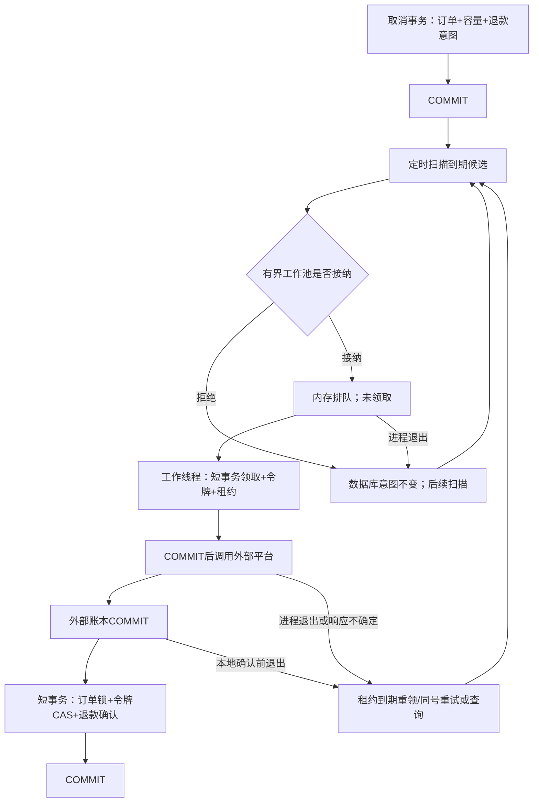

# 后台自动恢复、大表与持续负载

本轮日期为2026-10-15。保持单体与现有技术栈，不改变用户+requestKey协议，也没有增加购物车版本、MQ、Redis分布式锁或真实支付。历史结果保留在[验证记录](VALIDATION.md)，本轮结果单独追加。

2026-10-19另补充[同单状态历史与调度对照](STATE_HISTORY_AND_SCHEDULING.md)，分别检查过程合法性、自动恢复边界及调度线程/异步执行的作用。本页的5秒延迟前后比较保留为历史组合方案观察，不将两项修改的作用合并归因。

## 确认的问题与实际修改

修改前，RefundService.processDue在调度线程中逐笔等待平台响应；项目没有指定调度池大小，Spring Boot 2.7.3默认只有一个调度线程。[官方调度说明](https://docs.spring.io/spring-boot/docs/2.7.3/reference/html/features.html#features.task-execution-and-scheduling)

独立模拟端延迟5秒的对照实验中，到期订单约4.22秒后才取消，普通退款约4.90秒后才完成，确认了慢退款对其他任务的阻塞。该实验把扫描间隔设为200毫秒以隔离阻塞影响，不能当作默认配置的响应时间；订单超时使用显式时间夹具，另有真实截单等待实验。

| 修改 | 实际责任与代码 |
| --- | --- |
| 扫描与网络执行分离 | [RefundService.processDue](../sky-take-out/sky-server/src/main/java/com/sky/service/RefundService.java)只读取候选并尝试投递，不等待平台；手动local诊断仍可以同步执行同一process方法 |
| 有界退款工作池 | [RefundDispatcher](../sky-take-out/sky-server/src/main/java/com/sky/service/RefundDispatcher.java)默认2个线程、16个排队位置，AbortPolicy满队列拒绝；不会让调度线程代为执行网络调用 |
| 执行时领取 | 进入工作线程才开启领取事务；排队期间不设置租约、不增加attempts。队列拒绝或进程退出后，未领取的数据库任务仍在 |
| 进程内去重 | admitted集合减少同一实例反复排队；不能协调另一实例，不替代数据库条件领取或租约令牌 |
| 单项异常隔离 | 领取/确认等未能恢复的异常由工作线程记录后退出，释放admitted；[OrderTask](../sky-take-out/sky-server/src/main/java/com/sky/task/OrderTask.java)逐单捕获异常，继续处理同批其他订单 |
| 调度线程与观察 | [application.yml](../sky-take-out/sky-server/src/main/resources/application.yml)显式设置2个调度线程；[local指标](../sky-take-out/sky-server/src/main/java/com/sky/reliability/LocalReliabilityController.java)增加工作池和超时扫描计数，仍仅local且显式开启可访问 |

没有新增数据库迁移。关闭时最多等待工作池3秒，再发出中断；这不保证所有网络请求都已完成。排队任务尚未领取，在途任务靠已有租约和稳定退款号恢复。

## 正常与失败路径



这次改变的是调度与资源使用，退款的一致性边界没有改变：外部调用可能重复；稳定退款号负责平台去重，令牌只阻止旧执行者覆盖本地结果。队列的“接纳”不是数据库“领取”，更不是退款“成功”。

## 验证方式

```powershell
powershell -NoProfile -ExecutionPolicy Bypass -File scripts/build.ps1
python -m pip install -r scripts/reliability-requirements.txt

# 开启实际定时扫描，独立模拟端，两个应用，真实进程中断
python scripts/background_checks.py

# 十万条退款任务、十万级订单；读取实际Mapper SQL，无外部退款操作
python scripts/scale_checks.py --rows 100000 --repeats 20

# 三轮：每个场景10秒预热、120秒测量；轮间交替场景顺序
python scripts/endurance_checks.py --seconds 120 --rounds 3 --warmup 10 --workers 16 --pool 10 --skip-races

# 三个种子：各48单，随机支付/取消/超时/重放，期间中断一个实例
python scripts/endurance_checks.py --race-only --seeds 20261015,20261016,20261017

# 复核原有提交窗口、租约、幂等和数据库重试
python scripts/reliability_checks.py --skip-load
```

所有实验用唯一测试库、独立Redis与独立SQLite账本，保留正常业务数据；只停止脚本自己启动的进程。实验须顺序执行：各实验可以自行启动同一便携MySQL，不能在一个所有者关闭MySQL时让另一个实验依赖它。原始配置和日志保存在被忽略的.local内，不能公开。

background_checks的自动扫描间隔为200毫秒，平台读超时6秒；初始租约20秒，崩溃实验改为2秒，满队列实验改为1线程/1排队位置。业务默认仍为3秒退款扫描、30秒订单超时扫描、120秒租约、2线程/16排队位置。恢复耗时包含应用启动时应明确注明，不能把测试租约2秒说成服务2秒内恢复。

自动恢复检查覆盖：慢退款与超时扫描互不等待、队列拒绝后自动重扫、真实行锁导致领取重试耗尽而其他任务推进、外部已提交/本地提交前中断、真实租约换主、PROCESSING自动查询、自然截单与双实例真实退款意图积压。进程窗口使用实际终止与独立连接观察，不通过改status/lease_until冒充崩溃。

最终后台11项断言通过。延迟5秒的复核中，到期取消约0.80秒、普通退款约1.58秒；这是特定200毫秒扫描配置的一次观察，不是生产SLA或P95。40笔真实API产生的退款意图全部自动完成，账本各一笔退款；报告的drainIncludingCancellationMs约32.10秒，包括取消请求及数据库轮询开销，不是纯消费者耗尽积压时间。

随机竞争保存种子、订单/请求键映射及操作计划。种子复现操作、路由与延迟计划；每轮生成新的订单号和键，不能复现操作系统的精确线程交错。中断期间的传输错误与系统响应单独记录，使用原订单/原请求键转到存活实例恢复，不把它们混入无故障持续负载的错误率。

稳态负载沿用关闭自动退款、拉长订单超时扫描的隔离设置，循环加购→结算→取消未支付订单；它测量的是结算链路，不是包含支付退款的端到端吞吐。另用开启200毫秒扫描的混合竞争验证支付、取消、超时、退款与重启，每种子432个操作输入；实际尝试、准备和最终确认请求更多，不能混用这些计数。

## 大表测量与未采用的方案

58项Java单测、11项自动后台检查、31项旧可靠性回归、5项大表断言，以及六组120秒测量和三种子144笔混合竞争的最终记录见[最新验证](VALIDATION.md)与[脱敏证据](evidence/background-2026-10-15.json)。第一次长于十秒的负载发现过建连超时；后续清理跨轮HTTP会话并加TCP/JVM诊断，完整复核通过，原失败仍保留且根因未确认。

大表为直接SQL构造的性能夹具：100000条退款任务、105000条订单，其中5000条待支付，其余多为历史终态。退款分布为90000成功、5000失败、3000未来重试、500到期待处理、500过期租约和1000未到期租约。这些数据不代表十万笔真实资金闭环，自动扫描关闭，未提交模拟退款。

退款候选查询在该分布下实际使用idx_refund_retry和idx_refund_lease的覆盖范围扫描，两分支各20条，合并40条再取20条；暖缓存20次P50约0.81毫秒、P95约1.03毫秒。这补充了上轮小样本未验证的V5索引证据，没有强制索引。

只有截单到期时，现有超时查询返回100条前读取约4600条待支付记录，暖缓存P50约10.59毫秒、P95约14.26毫秒。拆为时间到期与餐次到期的UNION ALL后，优化器仍扫描约5000条并排序，P50约14.43毫秒、P95约17.24毫秒；混合到期样本也没有延迟收益，因此未修改生产Mapper或添加索引。脚本保留候选方案、EXPLAIN ANALYZE和Handler计数，不能把“拆OR”本身称作优化。

计时含Python客户端数据库往返；每个查询先预热3次，再同连接测20次。Handler读操作数不等于唯一业务行数或逐条锁定数量，应结合实际计划解释。测试仅覆盖这一规模与分布、暖缓存，不证明百万活跃任务或冷缓存表现。

## 面试追问

1. 为什么退款已经放在事务外还会阻塞超时处理？事务外解决数据库锁持有时间；原调用仍占用共用调度线程。对照实验观察到两种独立资源问题，修复在RefundService与RefundDispatcher。
2. 为什么不用CallerRunsPolicy？扫描线程执行被拒绝的退款会重新遭遇网络阻塞。AbortPolicy拒绝的只是本次内存投递，持久化任务仍在，因此可以后续扫描。
3. 为什么不先领取再入队？排队等待会消耗租约，满队列还留下无执行者的PROCESSING。当前process在工作线程启动后才条件领取，满队列实验核对了attempts=0。
4. admitted是不是分布式锁？不是，同一任务可以在两个进程排队；只有数据库claim成功的一方调用平台。令牌CAS与稳定退款号的责任也不同。
5. 一项数据库故障会不会终止整批？当前超时循环和退款工作隔离单项异常；真实锁住一个任务、让领取重试耗尽时，另一个任务仍完成。整个候选查询失败仍会中断本轮扫描，等待下一轮。
6. 为什么没有把SQL拆分方案合进去？实际计划与耗时没有收益，只有语法变化不构成优化。保留负结果和读操作计数比宣称未经测量的性能提升更可信。

## 仍然存在的边界

用户行锁、热门餐次行、连接池与单项数据库等待仍有成本；工作池不会消除这些热点。超时默认一轮最多100单、间隔30秒，积压处理速度仍受批量、间隔和锁等待限制。本轮没有实现自适应扫描预算、全局平台限流或自动扩容。

持续负载为本机两进程、16线程、两分钟测量窗口及三轮对照，不能称作通宵稳定性或生产容量认证。支付资金全模拟，跨机器网络分区、数据库切换、真实商户对账、CPU/IO全链路归因、长时间运行和浏览器点击验收仍未完成。生产告警、超长处理中任务治理、购物车版本与可靠通知outbox仍是后续建议。

候选领取仍是有界批次，单项异常隔离不构成任意故障下的全局公平性证明；整页候选都长期不可领取时，后续任务是否推进尚未验证。应结合活跃队列规模、失败告警和扫描退让策略再扩展，不把本轮单个锁阻塞实验扩大解释。
