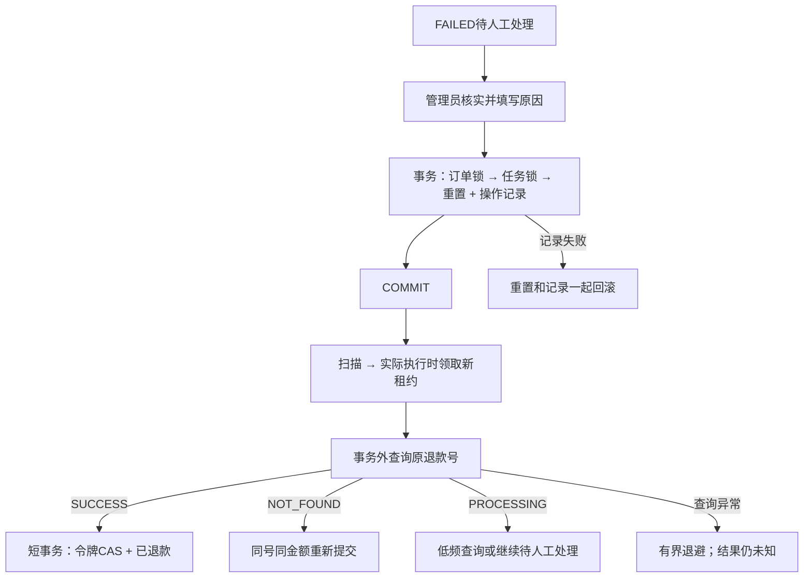

# 退款结果核查、人工恢复与受阻候选

本轮沿用单体与稳定退款号，在现有恢复链路上补充两个方面：本地停止重试后如何继续核实；一批候选被其他事务占住时，正常任务如何推进。历史实验保留在[验证记录](VALIDATION.md)。

## 本地执行与平台结果分开

`refund_task.status`仍表示本地任务的PENDING、PROCESSING、SUCCEEDED、FAILED。FAILED在管理页面显示“待人工处理”，不表示平台未退款。

V6增加`provider_state`保存最后记录的平台结果：UNKNOWN、PROCESSING、SUCCEEDED、CLOSED、ABNORMAL（以及查询未找到时的NOT_FOUND）。调用异常不能推断资金失败；已有PROCESSING等已知结果不会因为一次查询超时被改成“未退款”。`provider_checked_time`是本地写回的处理时间，不能充当平台资金提交时间。历史已成功任务回填SUCCEEDED，曾明确收到PROCESSING的回填PROCESSING，其余保留UNKNOWN。

第一次领取尝试提交退款；后续尝试，包括崩溃后租约重领、失败任务人工恢复，先查询原退款号。查询成功则完成本地确认；明确NOT_FOUND时才用原退款号及原金额重提。NOT_FOUND也不能证明前一个请求从未到达，所以仍必须依靠平台对同一退款号去重。查询本身超时、错误或响应格式异常时，不盲目再发退款POST。

attempts是成功领取后的执行次数；一次执行可能先查再提交，因此不等于外部调用数。模拟端分别记录退款POST、查询和实际退款数，不能由任务attempts推断资金次数。

非local查询只将HTTP 404且错误码为RESOURCE_NOT_EXISTS解释为退款单未找到；商户不存在、鉴权错误及系统错误不走重提分支。其他状态按平台协议保留，CLOSED和ABNORMAL直接停止自动处理。参考[微信退款查询协议](https://pay.wechatpay.cn/doc/v3/merchant/4012791884)。真实商户、异常退款渠道操作及账单对账仍未验收。

收到PROCESSING默认60秒后查询；持续超过5分钟时逐步降低频率至5/10/20/30分钟。`sky.refund.review-after-seconds`默认86400，超龄且平台仍报告处理中时，转FAILED并记录PROCESSING_TOO_LONG。它是在下一次处理时检查的阈值，不是24小时准时触发的SLA。六次累计调用/确认失败仍停止自动处理。

| 配置 | 业务默认 |
| --- | --- |
| sky.refund.interval-ms | 3000毫秒 |
| sky.refund.lease-seconds | 120秒 |
| sky.refund.workers / queue-capacity | 2 / 16 |
| sky.refund.poll-seconds | 60秒 |
| sky.refund.review-after-seconds | 86400秒 |

## 人工重试也是事务

`POST /admin/refunds/{id}/retry`现在要求JSON正文`{"reason":"核实情况或重试原因"}`，原因非空且最多200字。管理JWT确定操作人，客户端不能指定操作人ID。

事务内先锁订单，校验已取消且已支付，再锁任务；仅FAILED可重试。任务重置、订单退款状态恢复PENDING，以及`refund_review`中的操作人、原因、此前平台结果和失败次数一起提交。双实例竞争只允许一个决定成功。记录写入失败时，前面的任务重置也必须回滚。



`GET /admin/refunds/{id}/reviews`返回最近50条人工恢复记录。管理页面显示本地执行状态、平台最后结果、诊断和记录；人工重试保留原退款号与任务创建时间。平台明确关闭/异常时，人工重试也从核查原号开始，不会自动换号、改变退款金额或绕过平台规则。

## 绕过被锁住的候选

原扫描非锁定地取最前20条，随后逐项领取。当它们全被其他事务锁住时，后面的正常任务不会进入候选；单项异常隔离不能解决这个问题。

自动扫描现在用READ COMMITTED短事务，分别读取PENDING到期和PROCESSING租约过期候选，`FOR UPDATE SKIP LOCKED`跳过其他事务持有的行；两分支各最多20条，合并后最多20条。扫描事务提交、释放临时锁后才投递工作池，工作线程开始时才条件领取租约。候选锁不是持久化领取，也不增加attempts；进程内去重及跨实例CAS责任不变。

查询仍使用现有(status,next_retry_time,lease_until)及(status,lease_until)索引，按时间前缀排序，不额外按非连续索引列排序。实际扫描范围和计划另行实测，不只依据SQL外观判断。

候选上的临时锁不替代租约：扫描提交后，两实例仍可能投递同一任务，最终由执行时的条件领取和令牌CAS决定谁能写回。队列满也没有已领取的持久化任务需要撤销。

此方式允许略过被占用的候选，适用于任务表；它不提供业务快照或严格FIFO，不处理元数据锁、数据库不可用及任意故障下的全局公平性。参考[MySQL锁定读](https://dev.mysql.com/doc/refman/8.0/en/innodb-locking-reads.html)。

测试夹具同样要检查锁范围：小表中`IN(20个ID) FOR UPDATE`可能选择全扫描，RR下可能连不匹配的正常行也锁住。对照改用逐个主键等值锁，并用独立事务NOWAIT确认第21行确实可锁，再开始扫描实验。失败的初版夹具保留，不算业务失败证据。

## 验证方式

```powershell
powershell -NoProfile -ExecutionPolicy Bypass -File scripts/build.ps1
python scripts/refund_recovery_checks.py
python scripts/reliability_checks.py --skip-load
python scripts/background_checks.py
python scripts/state_history_checks.py
python scripts/scale_checks.py --rows 100000 --repeats 20
powershell -NoProfile -ExecutionPolicy Bypass -File scripts/build-front.ps1
```

实验顺序运行，使用唯一库、独立Redis与SQLite，不写正常业务库。新模拟端可分别配置退款提交前不处理、提交后响应异常，以及查询的重复错误/处理中响应；账本和故障次数可跨模拟端进程重启保留。退款实际处理数、退款POST次数和查询次数分别统计。

2026-10-19开始、20日00:01完成最后检查：63项Java单测、14项退款核查、31项既有故障回归、11项后台检查、27项状态历史检查和8项大表检查通过，Vue构建成功。原版59项单测JAR的独立对照确认：前20行被锁时，第21行在6秒观察期仍PENDING；新实现能完成第21笔，持锁20笔的attempts保持0，解锁后21笔各实际退款一次。

真实退避耗尽实验中，模拟端已实际退款一次，本地首响应异常且后续5次查询错误，最终任务FAILED/平台结果UNKNOWN。人工恢复记录写入失败会回滚任务重置；双实例竞争仅保存一条恢复决定。重启应用与模拟端后查询原号完成确认，合计1次退款POST、6次查询、1次实际退款，没有第二次退款POST。它验证恢复策略，不是外部恰好调用一次。

十万任务上，新SQL使用idx_refund_retry与idx_refund_lease范围扫描，无额外排序；每次新RC事务、预热3次、测量20次。PENDING/过期租约查询P50为1.17/0.71毫秒，P95为1.92/0.92毫秒；锁住前20条的PENDING查询P95为1.58毫秒且返回后续20条。时间包含查询往返，不含BEGIN/ROLLBACK，也不是应用吞吐；Handler计数和返回行数不等于被跳过行的完整内部扫描成本。

详细命令、环境、原始运行编号、测试框架失败及未执行项见[验证记录](VALIDATION.md)和[脱敏证据](evidence/refund-review-2026-10-19.json)。人工恢复记录不等于完整资金审计；当前仍无主动支付对账、退款通知闭环、跨机或数据库切换验收。

## 面试追问依据

**FAILED能不能直接展示“退款失败”？** 不能。RefundService的异常分支只证明本地未确认；provider_state保留最后平台观察。上述实验实际已退，但本地六次未确认后仍是UNKNOWN，页面因此显示“待人工处理”。

**为什么恢复先查询，NOT_FOUND后仍要用原号？** RefundPolicy根据attempts判断后续尝试，覆盖首次调用后没保存响应就崩溃的情况。NOT_FOUND也可能是暂时不可见，原号负责平台去重；查询错误不能解释为未处理。实际恢复只增加查询，没再提交退款。

**SKIP LOCKED是不是已经领取任务？** 不是。RefundService候选事务提交后才投递，队列里没有租约；执行时仍需条件领取并按令牌写回。双实例可以选中相同候选，扫描锁只解决被占用行阻塞后续工作，不保证严格FIFO。

## 关键实现

- [RefundService](../sky-take-out/sky-server/src/main/java/com/sky/service/RefundService.java)：候选短事务、执行时领取、查询优先、令牌写回及人工重置事务。
- [RefundPolicy](../sky-take-out/sky-server/src/main/java/com/sky/service/RefundPolicy.java)与[RefundTaskMapper](../sky-take-out/sky-server/src/main/java/com/sky/mapper/RefundTaskMapper.java)：结果分类、时间预算、锁定查询及条件更新。
- [V6迁移](../sky-take-out/sky-server/src/main/resources/db/migration/V6__refund_review_and_provider_state.sql)：平台最后结果与人工恢复记录，保留旧任务事实。
- [恢复检查](../scripts/refund_recovery_checks.py)与[模拟端](../scripts/mock_provider.py)：真实退避、独立账本、记录失败回滚及行锁范围验证。
