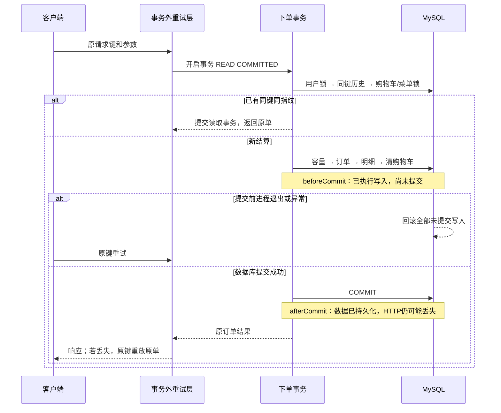
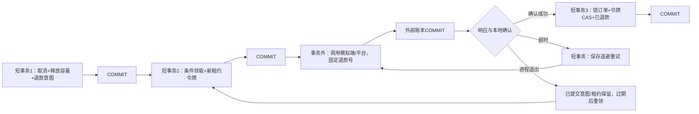

# 订单可靠性迭代与实验说明

本轮在2026-10-14开展，2026-10-15完成文档与计划复核，保留单体、Java 8、Spring Boot、MyBatis、MySQL和Redis。历史2026-10-11记录仍保留在[验证记录](VALIDATION.md)；本轮结果单独记录。

## 核对结论与修改位置

| 分类 | 结论及处理 | 实现位置 |
| --- | --- | --- |
| 原协议已实现 | 用户+请求键唯一、历史结果优先、购物车协调、条件预占及同库事务均保留；允许同用户同餐次用新键再次下单 | [OrderServiceImpl](../sky-take-out/sky-server/src/main/java/com/sky/service/impl/OrderServiceImpl.java)、[ShoppingCartMapper](../sky-take-out/sky-server/src/main/java/com/sky/mapper/ShoppingCartMapper.java) |
| 确认的数据库并发缺陷 | 持续负载发现取消先改子表status，经外键检查取得餐次S锁，再释放容量需升级X锁；并发取消互相等待。取消和迟到支付改为先释放容量取得父行X锁，再更新子表状态，均保留同一事务 | OrderServiceImpl.cancelLocked / paySuccess；[实际死锁摘录](evidence/cancellation-fk-deadlock.txt) |
| 客户端协议问题 | Vue可丢弃结果不确定的草稿；微信草稿按JWT识别用户，续签或切换用户会丢失重试关联。现在结果不确定时保留原载荷，Vue阻止提前换键，微信按登录响应的用户ID保存各自草稿，401/503保留草稿 | [Customer.vue](../project-rjwm-admin-vue-ts/src/views/meal/Customer.vue)、[微信请求模块](../mp-weixin/common/vendor.js)、两份Node检查脚本 |
| 验证缺口 | 原退款模拟固定成功；旧的“崩溃后租约”检查是修改字段构造的夹具。本轮新增独立、持久化、可计数的模拟端，并真正中断测试进程 | [mock_provider.py](../scripts/mock_provider.py)、[LocalProviderClient](../sky-take-out/sky-server/src/main/java/com/sky/reliability/LocalProviderClient.java)、[reliability_checks.py](../scripts/reliability_checks.py) |
| 恢复能力补充 | 增加有界整事务重试；数据库错误用HTTP 503表示，避免计入业务规则拒绝 | [DatabaseRetry](../sky-take-out/sky-server/src/main/java/com/sky/reliability/DatabaseRetry.java)、[DatabaseRetryAspect](../sky-take-out/sky-server/src/main/java/com/sky/reliability/DatabaseRetryAspect.java)、[GlobalExceptionHandler](../sky-take-out/sky-server/src/main/java/com/sky/handler/GlobalExceptionHandler.java) |
| 查询结构改进 | 原退款索引的next_retry_time夹在status和lease_until之间，不能为过期租约分支提供完整范围前缀；V5增加(status,lease_until)，候选查询拆为两段索引范围，再合并最多40个候选取20个 | [V5迁移](../sky-take-out/sky-server/src/main/resources/db/migration/V5__refund_lease_scan_index.sql)、[RefundTaskMapper](../sky-take-out/sky-server/src/main/java/com/sky/mapper/RefundTaskMapper.java) |
| 设计取舍 | 指纹不冻结购物车、不承诺通知必达；热门餐次依然竞争一行。没有改为一用户一餐次一单，也没有增加Redis锁、MQ或微服务 | 下文协议及限制 |

仓库及工作目录祖先未发现AGENTS.md；开始时目标仓库工作区干净。原项目目录未修改，依赖安装产生的无关yarn.lock重写已还原。

## 键、指纹、锁和状态各管什么

| 机制 | 责任与边界 |
| --- | --- |
| requestKey | 客户端标识一次结算意图。Vue使用16字节随机值，微信使用时间和随机字符串；服务器校验8至64位格式。网络断开、超时、401或503后复用原键与完整参数；确认成功后开始下一笔，或明确业务拒绝后修正再提交，生成新键 |
| requestHash | SHA-256记录请求中餐次、联系人、备注、地址、配送及餐具等字段。相同键相同指纹返回原单，指纹不同拒绝。客户端金额、当前购物车及当前菜单价格不参与；省略值和显式默认值并未统一归一，客户端必须冻结原载荷 |
| 用户行锁 | 下单和购物车写入口先锁同一用户行。同键串行检查历史结果；不同键不能同时消费同一份购物车；加购与结算先后执行，份数不丢失。不同用户不共享此锁 |
| 购物车锁/菜单共享锁 | 当前结算读取该用户购物车，按稳定商品顺序锁定当前价格和启售状态，保存订单快照。购物车(user_id,id)索引限制扫描范围 |
| 容量条件更新 | 对餐次主键行检查开放、截单和余量，预占更新影响1行才继续。订单、明细和清购物车失败会一起撤销预占 |
| 唯一约束/状态条件 | 用户+键防重复持久化；订单行锁和带旧状态/pay_status的UPDATE协调支付、取消、超时和核销；只由首次取消释放一次份数 |

一旦原单已提交，后续加购、改价、餐次关闭均不改变重放结果。若首次尝试从未提交，重试仍会结算当时的购物车和价格；跨设备修改购物车不会被请求指纹检测。这是现有协议的边界，严格冻结购买清单需增加购物车版本或持久化草稿，尚未实现。

## 正常与失败的事务边界





退款确认事务内先锁订单、再更新任务，与取消/退款失败/人工重试使用相同顺序；领取仅更新任务并立即提交，不持有任务锁去等待订单。下单路径是用户→购物车→菜单→餐次→新订单；取消是锁已有订单→释放餐次容量取得X锁→更新取消状态→退款意图。原顺序先改状态取得父行S锁，再释放时出现S到X升级死锁；调整后如状态更新失败，前面的容量释放也回滚。不同路径及其他外键检查仍可能形成冲突，不能证明全系统无死锁。

## 故障前后留下的证据

故障屏障由[可靠性探针](../sky-take-out/sky-server/src/main/java/com/sky/reliability/ReliabilityProbe.java)提供，只在local且显式开启`sky.local.reliability.enabled=true`时工作；管理JWT鉴权，默认关闭，其他profile即使打开属性也不生效。屏障只暂停，测试脚本根据自己的Popen句柄终止进程。

| 中断位置 | MySQL观察 | 独立模拟端观察 | 恢复行为 |
| --- | --- | --- | --- |
| 下单beforeCommit | 写入已执行，但另一连接看不到新订单；杀进程后订单无残留、份数0、购物车保留 | 无退款记录 | 原键可重新结算 |
| 下单afterCommit、HTTP返回前 | 订单可见、份数已预占、购物车已清空 | 无退款记录 | 重启或另一实例用原键返回原订单 |
| 外部退款提交后响应超时 | 取消及意图已提交，本地仍已支付/PENDING；保存失败计数与退避 | 已有1笔退款、1次调用 | 再调用相同退款号；调用数2，实际退款仍1 |
| 退款确认beforeCommit后杀进程 | 领取已提交为PROCESSING；完成任务/已退款的写入尚未提交，退出后回滚 | 已退款1笔，账本独立保留 | 租约真实到期后另一实例领取，同号恢复；同时重启模拟端仍保留账本 |
| 旧执行者超过租约迟到返回错误 | 新令牌已完成SUCCEEDED，旧令牌reschedule影响0行，失败计数及订单不变 | 同号调用2次、实际退款1次 | 旧执行者无法覆盖新结果；外部调用仍可能重复 |
| PROCESSING响应 | 保存provider_submitted=true与下次查询时间 | 已有同号退款记录 | 下轮query确认；退款POST仍1次、查询1次 |

“一条SQL执行成功”“服务方法返回”“事务已提交”和“客户端收到结果”是四个不同节点。单凭库里修改status/lease_until不能证明真实崩溃恢复；本轮崩溃实验使用实际进程退出及独立连接观察，租约按真实时间等待。

## 整事务重试的具体限制

`DatabaseRetryAspect`的Order比默认事务advisor靠外一层；每次proceed重新进入事务，异常退出已回滚后才再次执行。没有外层事务时每次是新事务；若入口已加入调用者事务，则只执行一次，把重试责任留给外层，避免在rollback-only事务内重试。

默认最多3次尝试，25毫秒起步的指数退避加随机扰动，可配置但最多5次。只接受MySQL 1213/40001死锁，以及1205的HY000或Connector/J映射的40001锁等待超时。不会自动重试唯一约束、业务异常、08S01断连或提交结果不明的错误。锁等待超时在数据库默认配置下可能只回滚一条语句，Spring异常退出负责回滚整个事务再重启。[MySQL错误处理](https://dev.mysql.com/doc/refman/8.0/en/innodb-error-handling.html)、[Connector/J错误映射](https://dev.mysql.com/doc/connector-j/en/connector-j-reference-error-sqlstates.html)

下单、支付状态写入、取消和超时入口应用该注解。退款仅对领取及确认/失败/人工重试的短事务重试，平台网络调用不包入重试闭包；新尝试重新计算领取时间，避免重试后得到已过期租约。支付创建接口不自动重试，退款HTTP重试仍由任务状态和稳定退款号控制。

尝试次数有界不代表总耗时固定；仍受数据库锁等待/网络超时配置影响。非local配送距离检查仍在结算事务内读取外部地图，Redis营业状态也为外部读，不是纯SQL路径；没有跨系统原子性保证，应进一步缩短这类等待。不能将整个含支付/退款网络调用的方法直接加重试注解。

## 复现方式和结果

```powershell
# 先使用现有bootstrap准备JDK、Maven、MySQL数据目录及Redis；构建时不要运行同一个JAR
powershell -NoProfile -ExecutionPolicy Bypass -File scripts/build.ps1
python -m pip install -r scripts/reliability-requirements.txt

# 一条命令创建测试库、独立Redis、模拟端及两个应用；结束自动停止自己启动的进程
python scripts/reliability_checks.py --load-seconds 10 --workers 16 --pools 3,10

# 可单独复现对应部分
python scripts/reliability_checks.py --skip-load
python scripts/reliability_checks.py --skip-load --retry-only
python scripts/reliability_checks.py --load-only --load-seconds 10 --workers 16 --pools 3,10

# 客户端协议验证，Vue检查需先安装前端依赖
node scripts/check-wechat-request.cjs
node scripts/check-campus-request.cjs
powershell -NoProfile -ExecutionPolicy Bypass -File scripts/build-front.ps1 -Install
```

每轮测试生成唯一`campus_rel_...`库及仅拥有该库权限的账号，原`sky_take_out`没有被导入、迁移或写入。Redis使用临时端口和独立目录，不复用原缓存。若3306已有MySQL，仅连接使用；若脚本自己启动MySQL，结束时仅关闭这个自有进程。测试库和`.local/reliability/<run>/`日志、账本、配置及报告保留，便于检查；配置含本地测试密码，不能公开。

环境为Windows、Corretto 8u504、MySQL 8.0.46、Redis 7.4.3、两实例同库。测试租约2秒（业务默认120秒），单连接锁等待1秒，模拟端读超时6秒；退款自动扫描关闭，使用同一process方法定向触发以控制故障时序。每个负载场景持续10秒、16线程，对比每实例连接池3和10；统计业务成功、业务拒绝和系统错误，最后核对订单、购物车、容量、请求唯一性与退款终态。

计时使用perf_counter/QueryPerformanceCounter，避免本机monotonic/GetTickCount64约15.6毫秒分辨率把短请求量化。数据库锁等待时间为全服务器累积毫秒，不能当作单请求耗时；data_lock_waits按测试库过滤的峰值是等待关系行数，不能当作线程数。连接池等待计数和毫秒为两实例增量之和。加购或取消的错误单独带phase记录，不混入下单P95；未获取端到端CPU/IO归因。

实测结果见本轮[脱敏证据](evidence/reliability-2026-10-14.json)及[验证记录](VALIDATION.md)追加章节。JVM堆为每实例384MB；压测为本机探索性短时实验，没有长期预热、多轮置信区间或线上对照。HTTP吞吐与下单吞吐分别记录，P50/P95统计结算请求，不包括整轮加购及取消的耗时。

实际交付：55项单测、37项可靠性断言通过，微信/Vue分别8/7项协议检查通过，Vue构建成功。6组10秒负载均0系统错误、0观测死锁、0数据库重试，最终业务数据一致。退款超时/崩溃恢复场景为2次调用、1次实际模拟退款；PROCESSING恢复为1次退款POST、1次查询。

计划复核中，已有同键行使用唯一索引const读取，购物车使用用户索引。退款表样本小且任务全部终态，PROCESSING分支仍选择旧覆盖索引并排序；V5只是补齐索引与查询结构，未验证大规模活跃队列效率。早期客户端连接错误和低精度计时轮不用于性能对照，最终使用每线程会话及高精度时钟。

## 核心追问与实现依据

1. 同键重试为什么不检查当前购物车？原单一旦提交，购物车已清空，重新校验会让安全重放失败。`getByRequest`位于营业、计价和容量检查之前；保存订单快照作为原结果。第一次从未提交时仍可能消费后来变化的购物车，这是未版本化协议的取舍。
2. 用户锁和唯一约束不是重复了吗？唯一约束只保证同键最多一条；用户锁还协调不同键和加购，不能同时消费同一购物车。双实例的不同键检查和加购/结算份数守恒验证了这点。
3. 事务方法返回就说明已提交吗？代理在目标方法返回后才提交。探针放在beforeCommit时写入已经执行但尚不可见，afterCommit时已可见但响应尚未发送；两个位置杀进程得到不同持久化结果。
4. 为什么不能只重试失败的SQL？死锁可能已经回滚整个事务，锁超时也不能让业务前半段留在旧事务。外层retry重新执行整段，单测核对不同事务对象和回滚/提交次数，真实InnoDB死锁实验核对先前写入未叠加。
5. 为什么不重试所有DataAccessException？断连可能发生在提交后，结果不明；唯一约束和业务拒绝也不是暂时性锁冲突。只按明确vendor code及SQLState分类，耗尽后返回503，客户端保留原键。
6. 外部已退款、服务崩溃怎么办？取消意图已经持久化，外部账本另行提交；租约过期重领，同号重试或查询。实验显示两次调用、一次实际退款，证明重复尝试可恢复，不能宣称调用恰好一次。
7. 令牌能阻止重复外部退款吗？不能。令牌只保护本地写回，旧执行者仍可发外部请求；外部去重依赖稳定退款号和平台协议。迟到错误响应实验验证旧令牌不能覆盖新成功。
8. 两实例就证明生产可靠了吗？只验证本机两进程共享同库的指定竞争与故障窗口，未验证跨机器网络分区、数据库主从切换或真实商户对账。负载结果也必须带场景、时长、连接池和错误分类。

## 尚未解决的瓶颈及下一步

用户锁把同一账号的请求串行化，热门餐次计数仍是一行热点；扩大连接池可能让更多连接等待同一行，也可能减少应用侧排队，需要根据采样解释而不能只看QPS。探针和指标端点只服务local实验，尚未建设生产监控。

本轮池3/10时：同用户重放约790/769次每秒，P95约33/35毫秒；热门餐次成功结算约124/128次每秒，P95约63/69毫秒，业务拒绝增多。增大池降低了池等待，却增加热点行等待；分散餐次未观测行锁等待，吞吐约280/276次每秒。只据该样本提出下一步：考虑已提交幂等结果的只读快速查询、缩短锁内工作和全链路耗时追踪，再确定池及限流参数；这些优化尚未实现。

本轮没有引入限流。可先用分用户/接口并发上限及全局有界队列保护连接池，在拒绝新请求时给出429和明确重试语义；已有结果重放应保留恢复通道。限流减少过载积压，不代替容量SQL、事务或幂等。阈值需要更长、多轮负载和超时预算后确定。

后续优先：缩短锁内操作和外部读、补购物车版本语义、真实平台通知及对账、长期失败任务告警、可靠通知outbox，以及大表候选扫描和更长负载测试。没有实现这些后续方案，也没有浏览器点击或微信开发者工具验收。
