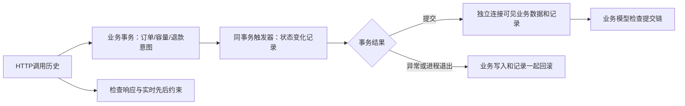

# 状态历史验证与调度对照

本轮日期为2026-10-19，沿用现有单体、请求键协议和退款模型。重点是把原来的最终数据检查扩展到过程检查，并分开测量调度线程与异步执行的作用。历史验证保留在[验证记录](VALIDATION.md)，本轮结果另行追加。

## 状态验证的范围

[独立模型](../scripts/order_state_model.py)直接描述业务规则，不读取Mapper或复制SQL。它接收订单状态、支付状态、退款状态，以及明确的过期/截单/取餐窗口上下文，预测操作允许与否。它分两层检查：

1. 同步阶段关闭自动退款；记录每次HTTP调用的开始、结束和业务结果，枚举不超过8个完整操作的合法串行顺序，要求顺序尊重“前一个响应已结束，后一个请求才开始”的约束，并与实际最终状态相符。
2. 隔离测试库中的InnoDB触发器记录订单插入和状态变化。记录与业务事务一起提交或回滚，检查每次已提交变化、前后连续性以及该餐次的份数。每个用例使用独立餐次且仅一笔订单；此份数检查不能直接推广到共享餐次。



这不是任意历史的形式化证明。同步历史不包含未完成HTTP操作和异步退款；后者单独检查。测试触发器只安装在脚本生成的库中，不是生产审计功能，且会改变执行开销，不能使用本轮耗时作为吞吐基准。创建触发器需要已有本地root连接；没有修改全局binlog或权限配置。

[执行脚本](../scripts/state_history_checks.py)覆盖七种起点：待支付、待接单、备餐、待自提、过期未支付、完成、取消。每笔订单的多个操作通过线程屏障同时发起，跨两个应用实例；测试连接先锁住订单行，观察冲突请求在MySQL实际等待，再释放，确认服务端操作重叠。状态不匹配的confirm/ready可能合法地提前拒绝，此时记录返回结果，不强制它们等待行锁。它只暂时持锁，不修改状态制造竞争。

退款核查轮为编排留3秒余量，将该脚本的应用连接锁等待设为5秒，基础Lab其他实验仍为1秒；逐次保存等待数和提前拒绝。初版0.8秒屏障曾未满足全员等待条件，失败记录保留，未定位到具体慢请求；不把它当作已确认的业务缺陷，也不放宽业务模型或静默重试。

另有四阶段履约历史：未接单时的错误操作、接单、备餐/核销竞争、重复核销竞争。前后阶段存在真实时间先后约束，检查恰好一次核销及完整提交链。支付、过期和取餐窗口使用明确披露的时间夹具，不声称自然经过15分钟。

[模型反例测试](../scripts/test_order_state_model.py)验证检查器能够拒绝取消后复活、两次成功核销、不可能的时间顺序和容量泄漏。

## 自动恢复与显式补发分开

同步竞争结束后不补发支付或取消。开启两个实例的扫描，允许它们仅推进已存在的退款意图；原本已完成或备餐中的订单应保持原状，再核对独立模拟账本。

退款确认提交前的真实进程中断额外验证：外部账本已有退款，本地订单及触发器审计均未确认成功；进程退出后，两者未提交的变化一起回滚。另一实例在真实租约到期后领取，最终只增加一条已提交的退款成功记录。

增加`payment.providerRecorded`屏障：独立模拟端记录支付后、应用处理回调前中断测试自有进程。先只观察，不补发请求；再明确记录一次回调重投。当前没有支付主动对账，不能把这一步重投称作后台自动恢复。该屏障仅local且显式启用可靠性实验时生效。

## 调度的单变量对照

[调度脚本](../scripts/scheduler_ablation.py)使用同一个JAR，保持扫描间隔200毫秒、外部提交后延迟响应、退款工作池和队列设置一致，比较：

| 扫描中的退款执行 | 调度线程数 | 要分辨的问题 |
| --- | --- | --- |
| 同步 | 1 | 慢退款是否同时拖延超时扫描和普通退款 |
| 同步 | 2 | 增加调度线程能否让同一退款扫描自身并行 |
| 异步工作池 | 1 | 单个调度线程配合外部执行能否推进两类任务 |
| 异步工作池 | 2 | 当前组合方案的表现 |

另把两个退款工作线程全部占满，观察普通退款是否仍需排队，而订单超时扫描是否可以继续。每格重复三轮、打乱顺序，报告原始时间及中位数；三次重复不用于计算有代表性的P95。

用同一条数据库快照查询观察普通任务完成时慢任务是否仍未确认，避免跨查询的时间差产生错误因果判断。计时从已观察到慢调用提交后开始，不含应用启动；仍包含取消请求及轮询开销，不是服务端纯执行时间。

慢调用在计时起点前已经开始，因此该时间也不是完整的5秒平台延迟。实验不能据此计算默认配置的性能提升比例，或推导调度线程数1优于2。

同步对照由`sky.local.reliability.synchronous-refund-scan=true`控制，同时要求local与`sky.local.reliability.enabled=true`。默认关闭；非local或未开启可靠性实验时无效。[隔离检查](../sky-take-out/sky-server/src/test/java/com/sky/reliability/ReliabilityProbeTest.java)覆盖开关边界。正常默认仍采用有界异步工作池。

## 复现

实验须顺序运行，使用各自唯一数据库、Redis和独立SQLite账本，仅关闭自己启动的进程。

```powershell
powershell -NoProfile -ExecutionPolicy Bypass -File scripts/build.ps1
python -m unittest discover -s scripts -p test_order_state_model.py -v
python scripts/state_history_checks.py --seeds 20261019,20261020,20261021
python scripts/scheduler_ablation.py --rounds 3
```

实际完成24组/126次操作、27项状态与恢复检查、18组调度对照；Java单测59项，模型检查器5项，原有故障回归31项。详情见[验证记录](VALIDATION.md)和[脱敏证据](evidence/state-history-2026-10-19.json)。本轮不使用旧轮次结果代替新实验。

## 面试展开

- 最终数据一致还不够：同单并发检查响应是否存在符合业务规则和时间先后的执行顺序，事务内审计再检查已提交变化；采样负责检查可见状态，不能证明采样间隙没有问题。
- 事务内审计不是提交时间戳：记录在事务中插入，仅提交后对观察者可见；同一订单的链由业务锁/CAS串行保护，不把不同订单的自增编号当作全局提交顺序。
- 退款自动恢复与支付回调重投不同：已有持久化退款意图可以由扫描继续；外部已支付但本地尚未处理时，当前仍需要回调再次送达或未来增加对账。
- 调度线程和退款工作线程解决不同资源约束：增加调度线程不能让同一个定时扫描自动重入；异步执行仍受工作线程、队列和数据库限制。
