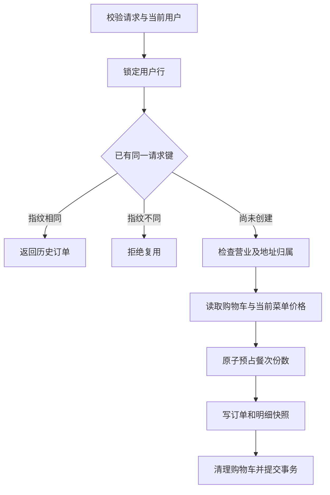

# 校园午餐订单与退款设计

2026-10-14补充有界整事务重试、外键共享锁升级死锁修复、独立退款账本、真实故障窗口及双实例负载验证，详见[可靠性迭代](RELIABILITY_ITERATION.md)。以下基础协议与业务状态保持一致；最新实验单独记录，不改写2026-10-11结果。

2026-10-19补充[状态历史与调度对照](STATE_HISTORY_AND_SCHEDULING.md)：现有业务协议不变，新增隔离测试库中的提交历史、独立状态模型和真实同单竞争；同一构建包分别比较调度池与异步退款执行。模拟支付在外部记录后、本地处理前中断时仍依赖回调重投，尚无主动支付对账。

系统在原外卖订单中增加fulfillmentType区分配送与自提。自提订单关联餐次并记录预占份数和随机取餐码；配送订单保留原收货地址。两种履约方式共用计价、支付、取消和退款处理，自提采用独立的备餐与核销入口。

## 预约规则与计价

餐次必须在未来7天内，截单时间早于自提开始，自提结束晚于开始，容量为1至5000份。份数按购物车数量求和，一个菜品或套餐计一份；这是餐次总容量，不是每种菜品的原料库存。容量在下单时预占；支付后继续占用；取消或超时释放；核销后仍作为该餐次已售份数保留。

当前费用是菜品与套餐总价，加每份1元餐盒费；配送加6元配送费，自提免配送费。费用从服务端配置读取。客户端和购物车缓存金额均不参与最终定价；菜单读取使用共享锁保护价格与启售状态，按类型及ID排序获取锁。每行数量限制1至99，总数量最多200。

## 下单事务

请求键必须为8至64位字母、数字、下划线或连字符，以用户为作用域。数据库唯一约束为`(user_id, request_key)`，指纹记录餐次、联系方式、备注、餐具和配送参数等语义。计价字段是服务端输出，不参加指纹。已有结果的查询先于营业、购物车与名额判断，所以重启、清空购物车、关闭餐次后仍可恢复相同结果。

购物车增减、清理、重复购买和结算使用同一用户行锁；结算事务使用READ COMMITTED。餐次使用`UPDATE ... SET reserved_count=reserved_count+quantity WHERE status=1 AND cutoff_time>now AND reserved_count+quantity<=capacity`，影响1行才继续。任意明细失败都会回滚容量、订单和购物车。数据库同时用CHECK约束保护计数范围及履约字段组合。

READ COMMITTED通常不对锁定查询的扫描范围施加间隙锁，外键与重复键检查仍是例外。本实现保留用户行锁、菜单共享锁及原子容量更新来保护业务数据，不依赖重复普通查询始终看到同一快照。[MySQL隔离级别](https://dev.mysql.com/doc/refman/8.0/en/innodb-transaction-isolation-levels.html)

购物车增加`(user_id,id)`索引，地址增加用户与默认标记索引。锁定SQL缺少合适索引时可能扫描并锁定过多记录；实际20用户并发检查曾在购物车锁定查询出现死锁，补齐索引与调整事务隔离后该场景通过。不能由此推导整个系统不会死锁。[MySQL锁定范围](https://dev.mysql.com/doc/refman/8.0/en/innodb-locks-set.html)

## 订单状态

| 数值 | 配送含义 | 自提含义 | 正常进入条件 |
| --- | --- | --- | --- |
| 1 | 待支付 | 待支付 | 新订单 |
| 2 | 待接单 | 待接单 | 金额正确的支付成功 |
| 3 | 已接单 | 备餐中 | 已支付，原状态2 |
| 4 | 派送中 | 待自提 | 已支付，原状态3；履约入口匹配 |
| 5 | 已完成 | 已核销 | 已支付，原状态4；自提还需有效码与时段 |
| 6 | 已取消 | 已取消 | 符合用户/商家/超时规则 |

payStatus为0未支付、1已支付、2已退款；refundStatus为NONE、PENDING、FAILED、SUCCEEDED。状态迁移由带原状态和payStatus条件的SQL完成，检查影响行数决定是否成功。订单支付、取消、超时和核销读取订单行锁；重复取消不重复释放份数。

用户只能在状态1或2且餐次截单前取消。商家可以在订单完成前取消；完成后不允许直接取消。待支付订单在下单15分钟后或餐次截单后取消，定时任务每30秒扫描候选，再逐单重新判断。

迟到的支付成功通知会让待退款资金进入已取消订单，持久化退款意图，并按原状态判断是否需要释放份数；已经取消的订单不能再次释放。不会把这类订单变成待接单。取餐码由16字节安全随机数生成，编码为22位URL安全字符，并有唯一约束。

## 退款任务与恢复

取消已支付订单与创建refund_task在同一数据库事务中完成。order_id与refund_number分别唯一，退款号固定为`R`加订单号。后台默认每3秒查询最多20个到期任务，交给每实例2个线程、16个排队位置的有界退款工作池。排队不领取任务，工作线程开始执行时才条件领取、设置2分钟租约和随机令牌；同一未过期租约只有一个领取者成功。队列满直接拒绝本次内存投递，数据库任务保留，下一次扫描或另一实例可以处理。

2026-10-15确认慢退款会阻塞原单线程调度：退款改为扫描与网络执行分离，调度池显式设为2个线程；进程内admitted集合只减少重复排队，跨实例协调仍依靠数据库条件领取。退款工作线程和超时批次分别隔离单项异常，后续扫描仍可恢复失败领取。[后台恢复实验](BACKGROUND_RECOVERY.md)

支付平台调用在事务外。后续尝试先查原退款号，明确NOT_FOUND才同号同金额重提；查询异常不转为盲目提交。确认成功后，短事务先锁订单，再按任务令牌完成任务及已退款状态。PROCESSING默认60秒后查结果，长期处理逐步降低频率；六次累计本地失败、超24小时仍处理中及明确关闭/异常转FAILED待人工处理。FAILED不表示资金未退，V6的provider_state独立保存平台最后结果。人工恢复需原因与管理身份，锁订单→锁任务后，重置与refund_review记录同事务提交。详见[退款核查](REFUND_REVIEW.md)。

自动候选扫描使用独立READ COMMITTED短事务，分别对待处理和过期租约候选执行FOR UPDATE SKIP LOCKED，两分支各最多20条，合并最多20条；扫描提交释放临时行锁后才投递。它不是领取，排队不消耗租约；实际执行仍用条件UPDATE领取。此方式避开其他事务锁住的候选，不保证任意故障下的严格FIFO或全局公平性。

任务执行期间进程退出，其他执行者可在租约过期后领取。旧执行者的结果无法越过新令牌更新任务。2026-10-14已真正中断自有应用进程、重启独立模拟端并等待租约到期验证这些窗口；外部接口仍可能重复调用，因此始终使用稳定退款号，不等于外部调用恰好一次。V5增加过期租约索引，候选分支各取最多20个再合并。

取消和未先取消的迟到支付，先锁订单，再释放餐次容量，最后更新子订单状态及退款意图，均在同一事务。先更改status会通过外键支持索引取得父餐次S锁，再释放容量升级X锁，持续负载已观察到并发锁升级死锁。容量释放后状态写入失败，仍须整体回滚。下单与这些DB状态入口使用事务外层最多3次重试，仅接受明确MySQL死锁/锁超时；平台调用不进入重试闭包。

## 身份与支付通知

用户订单和地址按当前登录ID查归属，不接受客户端userId。请求过滤器在进入及finally离开时清理ThreadLocal。管理端WebSocket在握手时用管理JWT验证身份，令牌放在子协议头中；教学用非JSON周期广播默认关闭。业务通知在事务提交后发送，但没有持久化与断线补偿。

非local支付通知先验证配置的平台证书及原始正文RSA签名、证书序列号和时间窗口，再用API V3密钥解密，并校验应用、商户、交易状态、币种及金额。验签和加密协议使用样本单测，真实商户联调需要另行配置凭证与证书管理。协议处理参考[微信支付通知文档](https://pay.wechatpay.cn/doc/v3/merchant/4012791902)；查询退款使用[微信退款查询接口](https://pay.wechatpay.cn/doc/v3/merchant/4012791884)。

## 文件入口

| 主题 | 核心代码 |
| --- | --- |
| 下单、支付、取消、状态 | [OrderServiceImpl](../sky-take-out/sky-server/src/main/java/com/sky/service/impl/OrderServiceImpl.java) |
| 计价与快照 | [OrderPricingService](../sky-take-out/sky-server/src/main/java/com/sky/service/OrderPricingService.java) |
| 备餐与核销 | [MealSessionService](../sky-take-out/sky-server/src/main/java/com/sky/service/MealSessionService.java) |
| 退款执行 | [RefundService](../sky-take-out/sky-server/src/main/java/com/sky/service/RefundService.java)、[RefundTaskMapper](../sky-take-out/sky-server/src/main/java/com/sky/mapper/RefundTaskMapper.java) |
| 幂等、容量与约束 | [V2迁移](../sky-take-out/sky-server/src/main/resources/db/migration/V2__reservation_and_order_integrity.sql)、[V3迁移](../sky-take-out/sky-server/src/main/resources/db/migration/V3__pickup_without_delivery_address.sql)、[V4迁移](../sky-take-out/sky-server/src/main/resources/db/migration/V4__user_scoped_cart_indexes.sql) |
| 学生与商家页面 | [Customer.vue](../project-rjwm-admin-vue-ts/src/views/meal/Customer.vue)、[Management.vue](../project-rjwm-admin-vue-ts/src/views/meal/Management.vue) |
| 可复现检查 | [smoke.py](../scripts/smoke.py)、[feature_checks.py](../scripts/feature_checks.py) |
